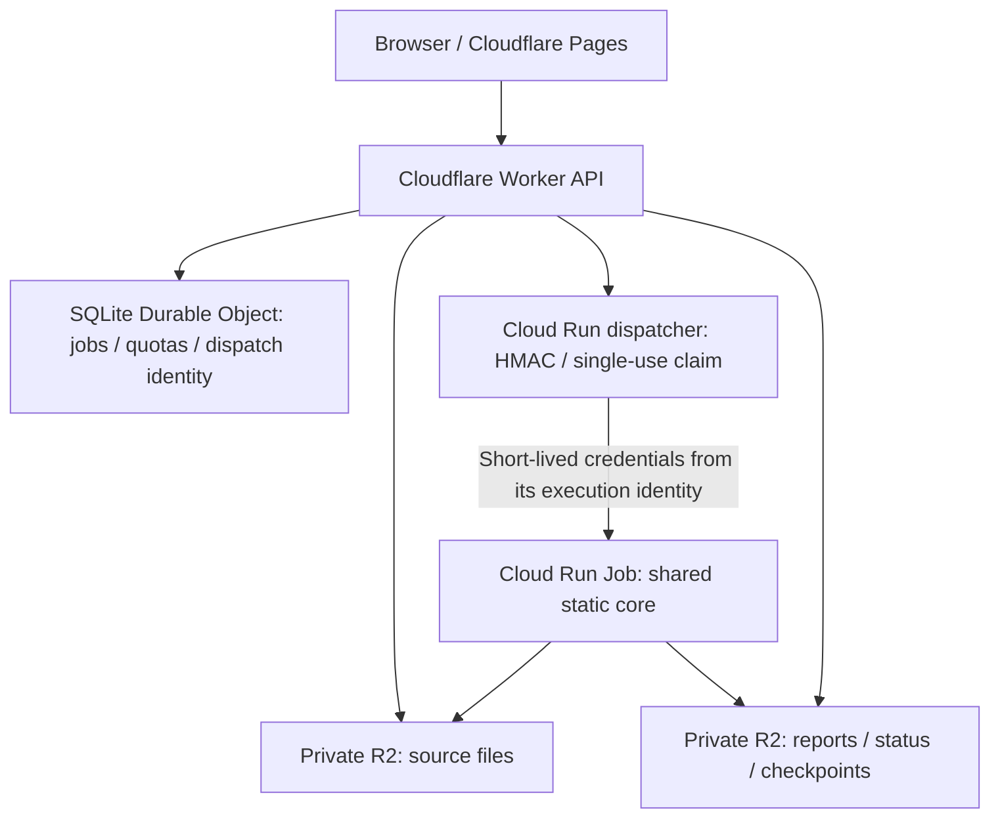

English | [繁體中文](README.md)

# MalScanWorker

A file analysis platform built around static analysis: upload files, trace archives and embedded children, and read reports with evidence, artifact lineage, coverage and explicit reasons for unfinished work. Self-hosted installations can add CAPE dynamic analysis. The cloud demo runs the same static core with separate usage limits.

**[Open the cloud demo](https://malscan-v2-demo.pages.dev)** · [Supported formats](docs/analysis-support.md) · [v2 architecture](docs/v2-architecture.md) · [Acceptance and maintenance](docs/cloud-demo-operations.md) · [Roadmap](docs/roadmap.md)

## Current milestone

**The first P1 static-quality batch is implemented:** 18 versioned quality cases, child-artifact evidence aggregation, explicit references for duplicate analysis, and tool/rule provenance display. It also fixes order-dependent inherited scoring and deobfuscation truncation coverage. See the [static quality baseline](docs/static-quality.md) for validation and known benign-rule hits. This is repository/local validation progress; the live cloud demo needs a new deployment to use these changes.

**2026-10-16 (Asia/Taipei): the current cloud acceptance batch is verified.** Production API tests covered nested archives, different ZIP/7z passwords with resume, a 20,000,000-byte file, and a 49-byte scan after image promotion. The 20 MB report correctly remains static `partial` because deobfuscation has a 10 MB limit; its required scans completed. See the [P0 acceptance record](docs/milestones/2026-10-15-p0-acceptance.md) for results and evidence boundaries.

Manual maintenance verified signed antivirus databases, clean/EICAR controls, image promotion and the subsequent scan's use of that image. After expiry, all four jobs had empty listings under their 28 R2 prefixes, and owner status/report requests returned 404. The project's month-to-date Google Cloud billing was reviewed in TWD: the net amount is near zero but positive before rounding. Durable Object row deletion, lifecycle settings, Cloudflare usage, longer-term costs, a live rollback and automatic database refresh remain operational follow-ups.

The **first full v2 cloud workflow**, recorded on 2026-10-15, ran on 2026-10-14 at 23:08–23:12 (Asia/Taipei). A user uploaded a 13-byte `hello.txt` through the production frontend, traversed the Cloudflare control plane, a dispatcher without Google private keys, a Cloud Run Job and private R2, and downloaded the complete static JSON report: `job_status=done`, `report_complete=true`, static analysis complete and dynamic analysis disabled.

That first execution took approximately **3 minutes 58 seconds** from creation to completion. Resource readiness to the reported start took approximately **2 minutes 45 seconds**; analysis recorded in the report took **29.3 seconds**. This is one historical baseline, not a latency guarantee. The current “queued” UI also covers execution environment preparation.

The earlier **20,000,000-byte upload / R2 download / scanning PoC** passed separately from application acceptance. See the [first cloud milestone](docs/milestones/2026-10-15-cloud-demo.md) and [local validation](docs/v2-validation.md).

## What it analyzes

| Capability | Current results |
| --- | --- |
| General static analysis | File type and hashes, ClamAV, YARA, IOCs, deobfuscation candidates and heuristic evidence |
| Format analysis | Windows PE, Office OLE/OOXML/RTF, PDF, LNK and supported scripts; depth varies by format |
| Recursive artifacts | ZIP, 7z, RAR, TAR, gzip, bzip2 and supported embedded document objects, with parent-to-child lineage |
| Passwords and resume | Password submission for supported archives, different passwords across nested archives, completed-stage checkpoints and cumulative extraction budgets |
| Explainable reports | Stage states, tool/rule versions, direct and descendant risk evidence, partial results and unfinished-work reasons |
| Optional dynamic analysis | A self-hosted CAPEv2 integration adds available process, file, registry and network evidence |

Reports distinguish no detections from tool errors, missing rules, password waits, budget limits and unsupported formats. `complete` means the declared scope for that analysis finished; no detections do not guarantee a file is safe.

Encrypted Office/PDF decryption, ISO extraction and dedicated deep analysis for ELF, Mach-O, email and APK are not implemented. RAR capabilities depend on an available external extractor. PDF attachment descriptions do not mean those attachments were extracted and scanned. Consult the [support matrix](docs/analysis-support.md) and each report's coverage.

## Choose a deployment mode

| Mode | Intended use | Infrastructure |
| --- | --- | --- |
| Cloud demo | Try static analysis within a limited allowance | Use the existing [demo](https://malscan-v2-demo.pages.dev), or deploy your own following the guides |
| Self-hosted static service | Accept uploads and continuously process work on your server | Docker Compose: API, Go Ingest, worker, PostgreSQL, RabbitMQ, MinIO, ClamAV and Nginx; start the frontend separately |
| One-shot static CLI | Local analysis, batch integration, container jobs and checkpoint recovery | Linux, Python and analyzer dependencies; local or S3/R2 storage, without PostgreSQL/RabbitMQ |
| Self-hosted static + dynamic | Add real behavior evidence to static results | The static service plus a working CAPE host, guests/snapshots and an isolated network |

### Cloud demo architecture



The Worker retains job identity, single-use upload authorization and quotas. The dispatcher validates the signature, atomically claims dispatch, then uses short-lived credentials from its own service account to run the fixed Job. **Cloudflare stores no Google service account private key.** Source and result buckets are private; the browser uses a job capability to access its own status and report.

The demo is static-only, with these current settings:

| Item | Current setting |
| --- | --- |
| Original file size | 1–20,000,000 bytes |
| Cumulative extraction across the tree | 20 files / 100,000,000 bytes / depth 3 |
| Analysis window / Cloud Run task timeout | 840 seconds / 900 seconds |
| New-job allowance | 10 per day |
| Execution allowance | 20 per day, 40 per month; includes password resumes and dispatches with uncertain outcomes |
| Retention | Configured to 24 hours; expiry checks found all 28 R2 prefixes empty across four test jobs; DO row deletion remains unverified |

Free-tier usage is a cost target, **not a zero-bill guarantee**. Cloud Run, builds/images, Secret Manager, storage and logging require cost observation. The product's self-hosted capabilities are separate from demo quotas.

Use the [production Pages origin](https://malscan-v2-demo.pages.dev) and retain the upload tab. Its capability is stored in that tab's `sessionStorage`: refreshing preserves it, while closing the tab normally loses access. If a response is lost, check the existing job before uploading again.

To deploy your own cloud environment, read the [Cloud Run guide](deployment/cloud-run/README.md), [keyless dispatcher guide](deployment/dispatcher/README.md), [Cloudflare guide](deployment/cloudflare/README.md) and [frontend build guide](frontend/README.md). The current demo frontend uses Cloudflare Pages. The existing GitHub Pages workflow is a separate option and requires the explicit `ENABLE_GITHUB_PAGES_DEPLOY=true` setting to publish.

### Self-hosted static service: local quick start

Install Git, Docker Compose v2 and Node.js/npm for the frontend. These steps use Compose's local development defaults; Supabase, Kubernetes and sandbox VMs are not prerequisites.

```bash
git clone https://github.com/daluoter/MalScanWorker.git
cd MalScanWorker
docker compose up -d --build
docker compose ps
```

The API creates tables for a new installation. If a root `.env` already exists, check `DATABASE_URL`: Compose containers should connect to `postgres:5432`, not their own `localhost`. `.env.example` documents configuration fields; its host addresses and placeholder passwords are not ready-to-use values for this Compose quick start.

Start the frontend in another terminal:

```bash
cd MalScanWorker/frontend
npm ci
VITE_BASE_PATH=/ VITE_API_BASE_URL=http://localhost:8000 npm run dev
```

Open `http://localhost:5173`; Nginx exposes the API at `http://localhost:8000`. Initial ClamAV database preparation can take time. Dynamic analysis is disabled by default. Compose credentials and exposed ports are development defaults; configure access controls and production credentials before exposing the service.

Before upgrading an existing database, back it up and stop old workers. Set `DATABASE_URL` for that database, run `poetry run alembic upgrade head` from `backend`, then start updated services. Migrations live in [backend/alembic](backend/alembic); adding model fields does not fully upgrade existing tables.

### One-shot static CLI and password resume

Use Linux, Python 3.11+, Poetry and native dependencies such as libmagic and ClamAV; RAR also requires an extractor. The example assumes a local `clamscan` installation with a valid database. Missing tools or rules leave explicit incomplete coverage.

```bash
cd worker
poetry install
export CLAMAV_MODE=cli
export YARA_RULES_PATH="$PWD/rules"

poetry run python -m malscan_worker.runtime --file /path/sample.zip --output-dir /path/analysis
# Resume with the same source, output directory and retained checkpoint
poetry run python -m malscan_worker.runtime --file /path/sample.zip --output-dir /path/analysis --resume
# Enter the root archive password at a hidden prompt
poetry run python -m malscan_worker.runtime --file /path/sample.zip --output-dir /path/analysis --resume --ask-password
```

For a nested artifact with a different password, use `--password-artifact ARTIFACT_ID`. Keep passwords out of command-line values. A successful process exit means results were saved; inspect `batch_analysis` and `report.json` for their actual outcome.

CLI defaults are 100 extracted files, 500,000,000 expanded bytes, depth 3 and a 3,600-second attempt window. Configure `--max-files`, `--max-expanded-bytes`, `--max-depth` and `--attempt-timeout` as needed. Resume preserves cumulative tree-wide usage instead of granting another extraction budget. See the [Cloud Run guide](deployment/cloud-run/README.md) for S3/R2 adapters and private signed checkpoints.

### Self-hosted dynamic analysis: one command after configuration

First provide a CAPE host reachable from containers, API access, analysis guests/snapshots and an isolated network. Configure the root `.env`:

```dotenv
SANDBOX_ENABLED=true
SANDBOX_PROVIDER=capev2
SANDBOX_BASE_URL=https://cape.example.internal
SANDBOX_API_TOKEN=REPLACE_WITH_YOUR_CAPE_TOKEN
```

```bash
scripts/enable-sandbox.sh
```

The script first performs a read-only `/apiv2/machines/list/` check for API access and an unlocked guest, then starts the static and sandbox workers. **It does not install CAPE, create VMs, or validate guest boot/snapshot restoration.** Local HTTP fixtures validate integration and recovery; live CAPE detonation remains an external acceptance task.

Static results remain readable while dynamic evidence arrives. Provider failures retain `failed`/`unavailable` states instead of switching to mock. An uncertain submission requires reconciliation rather than blind resubmission. Mock is an explicit development choice; synthetic results never count as real behavior. Recovery and multi-task limits are documented in the [v2 architecture](docs/v2-architecture.md).

## Reports, rules and antivirus databases

Reports use `report_schema_version=mswr-report-v3` and `analysis.schema_version=mswr-analysis-v1`, with separate `static`/`dynamic` states. Artifact trees, stage coverage, risk evidence and available tool versions explain what actually ran. JSON downloads and readable partial results are supported.

| Information in the milestone report | Meaning |
| --- | --- |
| YARA `4.5.4` | The `yara-python` tool version, not the ruleset version |
| YARA rules SHA256 | Identifies the loaded rules; the bundled [5 files / 15 rules](worker/rules) are a baseline ruleset |
| ClamAV `1.4.3` | The antivirus engine version in that cloud image |
| Database `28153`, `2026-10-14 06:24:15` | That database's serial and creation timestamp, not a lasting claim of upstream freshness |

The cloud image refreshes ClamAV signatures **at build time**, not during each scan. A seven-day freshness guard reports an antivirus-stage failure when the database is too old. **Automatic daily rebuilding/refresh is not implemented yet.** Compose uses a separate ClamAV service with its updater enabled by default. Expanding YARA also requires license/source tracking, versioning, false-positive evaluation and performance checks, beyond rule counts.

## Development, validation and next steps

| Location | Purpose |
| --- | --- |
| [frontend](frontend) | React/TypeScript UI with self-host and cloud-demo transports |
| [backend](backend), [ingest](ingest) | Self-hosted FastAPI query/report API and Go streaming uploads |
| [worker](worker) | Shared static stages, recursive extraction, portable runtime and CAPE adapter |
| [deployment](deployment) | Cloudflare, Cloud Run Jobs and keyless dispatcher deployment |
| [k8s](k8s), [GitHub Actions](.github/workflows) | Existing Kubernetes examples and CI/image/frontend workflows, maintained separately from the deployed cloud demo |

Local validation covers backend/worker/frontend tests, real PostgreSQL budgets and attempts, real ZIP/7z different-password recovery, full-container/S3 checkpoints and Worker-to-Python-dispatcher HTTP integration. Consult the [validation record](docs/v2-validation.md) for counts, commands and evidence boundaries. These tests do not replace live-provider or billing acceptance.

The first P1 static evidence and rule-quality baseline is in place. Next, use the observed benign-rule hits and more format-specific structural samples to improve false-positive and missed-detection measurements, followed by deeper format analysis and password/attachment handling. Remaining cloud maintenance and cost observations continue alongside that work. Measured performance improvements follow those static foundations; live CAPE acceptance depends on available infrastructure. The [project roadmap](docs/roadmap.md) defines the order and acceptance criteria.
