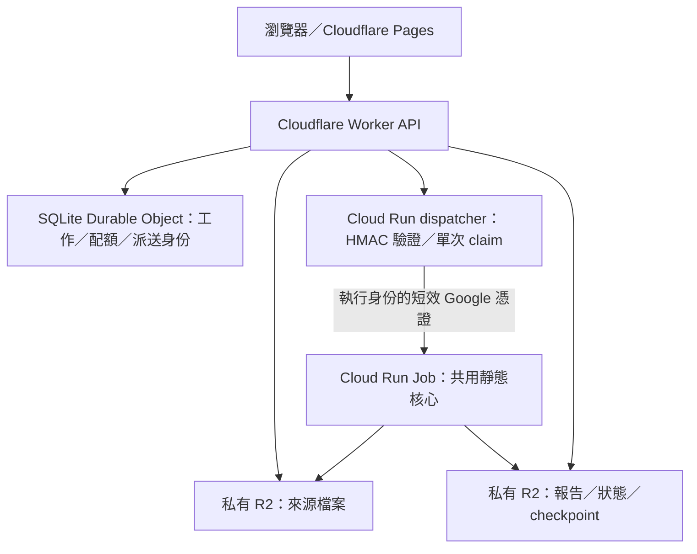

[English](README.en.md) | 繁體中文

# MalScanWorker

以靜態分析為核心的檔案分析平台：上傳檔案，追蹤壓縮檔與嵌入子檔，取得包含偵測證據、來源關係、分析範圍與未完成原因的報告。自架部署可另外啟用 CAPE 動態分析；雲端 demo 使用相同靜態核心，以有限額度展示產品。

**[開啟雲端 demo](https://malscan-v2-demo.pages.dev)** · [支援格式](docs/analysis-support.md) · [v2 架構](docs/v2-architecture.md) · [驗收與維護](docs/cloud-demo-operations.md) · [進度清單](docs/project-status.md) · [路線圖](docs/roadmap.md)

## 目前里程碑

**2026-10-18：PDF 密碼恢復與正式 demo 回饋修正。** 首批程式／本機驗證完成，使用者已提供 Job 切換及兩組原檔／解密子檔 JSON，確認實際解密掃描；Pages 發布及等待／錯誤狀態仍待完整核對。
本次修正明確的錯誤密碼提示、每個加密檔案各三次補交、紅色高風險呈現，以及 `msrs-v1.2` 的子檔風險逐層回傳；worker 852、backend 233、frontend 51、控制層 25 項通過，另有五項 opt-in skip；PDF 原生 12／12，32 份一般原生報告以最終 manifest 重新核對通過。詳見 [本批紀錄](docs/milestones/2026-10-18-pdf-feedback.json)，正式修正版本尚未上線。
ZIP 密碼使用一次不扣內層 PDF 額度，仍受全站 execution 限制；本檔分數與含子檔的有效風險分開保留。見 [PDF 密碼流程](docs/pdf-password.md)及 [Job→Worker→Pages 部署手冊](docs/deploy-pdf-feedback.md)。
[進度清單](docs/project-status.md)逐項追蹤 47 個 ID，包含仍待辦的 DO 清理、長期成本、真實回退及自動病毒庫更新。
首批 32／32 一般原生案例、12／12 PDF 密碼案例與歷史測試數字保留在 [首批紀錄](docs/milestones/2026-10-18-pdf-password.json)，不代替本次修正驗收。

**2026-10-17：P1 靜態品質第二批已驗證**：品質 corpus 擴充為 32 個案例／28 個固定 fixture，新增 PE、Office、PDF 結構與失敗對照；32／32 真實引擎案例通過。兩批變更的 worker／Pages 部署結果與三份正式 demo 報告已核對；PDF 密碼恢復為下一個獨立批次。驗收範圍見[靜態品質基準](docs/static-quality.md)，所有完成／待辦項目及條件見[進度清單](docs/project-status.md)。

**2026-10-16（Asia/Taipei）：本輪雲端核心流程與四筆 R2 保留期驗證完成，持續維護項目追蹤中。** 正式 API 已驗證巢狀 ZIP、不同密碼 ZIP／7z、20 MB 上傳及宣告的掃描範圍、檔案大小超限與已用票證拒絕；人工病毒庫映像更新及切換後的執行映像也已核對。四個工作共 28 個指定 R2 前綴確認為空，到期後工作／報告存取已撤回。目前 TWD 專案月內費用已核對為極低，並非精確零費用。詳見[P0 驗收紀錄](docs/milestones/2026-10-15-p0-acceptance.md)。

**2026-10-15（Asia/Taipei）整理：v2 雲端完整流程首次驗收成功。** 實際執行於 2026-10-14 23:08–23:12（Asia/Taipei）。使用者從正式前端上傳 13 bytes 的 `hello.txt`，經 Cloudflare 控制層、無 Google 私鑰的派送服務、Cloud Run Job 與私有 R2，取得可下載的完整 JSON 靜態報告：`job_status=done`、`report_complete=true`、靜態分析完成、動態分析停用。

這次 Cloud Run 執行從建立至完成約 **3 分 58 秒**，其中資源就緒至回報啟動約 **2 分 45 秒**，報告內分析時間約 **29.3 秒**。這是一次實測基準，並非速度承諾；畫面的「排隊」目前也涵蓋執行環境準備。

先前 **20,000,000 bytes 上傳／R2 下載／掃描 PoC** 與新版正式應用驗收分開記錄。新版 20 MB 案例的去混淆仍受 10,000,000-byte 上限限制，報告如實為 partial。DO 資料列／lifecycle、Cloudflare 實際用量、長期維護成本、真實回退及自動更新排程仍待核對；目前證據不代表所有 P0 維運條件已結案。首次流程與本機能力分見[首筆里程碑](docs/milestones/2026-10-15-cloud-demo.md)及[本機驗證](docs/v2-validation.md)。

## 可以分析什麼

| 能力 | 目前提供的結果 |
| --- | --- |
| 通用靜態分析 | 檔案型別與 hash、ClamAV、YARA、IOC、去混淆候選與啟發式證據 |
| 格式分析 | Windows PE、Office OLE／OOXML／RTF、PDF、LNK、支援的 scripts；各格式深度不同 |
| 遞迴子檔 | ZIP、7z、RAR、TAR、gzip、bzip2，以及支援的文件嵌入物件；保留原檔到子檔的來源樹 |
| 密碼與續跑 | 支援封存格式與 PDF 的密碼補交、巢狀不同密碼、已完成 stage checkpoint 與累計提取預算；PDF 基礎流程已有正式報告；逐檔計次與風險修正待完整驗收 |
| 可解釋報告 | 各階段狀態、工具／規則版本、直接與子檔風險來源、部分成果及未完成原因 |
| 選用動態分析 | 自架串接真實 CAPEv2，將可取得的 process／file／registry／network 等證據補入報告 |

報告將「已分析但未命中」、「工具失敗」、「無規則」、「等待密碼」、「超出預算」與「格式不支援」分開呈現。`complete` 表示該次宣告範圍已完成，沒有命中也不表示保證安全。

加密 Office 解密、ISO 提取、ELF／Mach-O／郵件／APK 的專用深度分析尚未提供；PDF 密碼恢復程式／本機驗證已完成，正式部署狀態見 F-08。RAR 能力取決於可用的外部解壓器；PDF 附件描述不代表附件已提取掃描。完整能力以[支援矩陣](docs/analysis-support.md)及每份報告的 coverage 為準。

## 選擇執行方式

| 模式 | 適合用途 | 需要的基礎設施 |
| --- | --- | --- |
| 雲端 demo | 直接試用有限額度的靜態分析 | 使用現有 [demo](https://malscan-v2-demo.pages.dev)，或依部署文件建立自己的環境 |
| 自架靜態服務 | 自己的伺服器接收上傳、持續處理工作 | Docker Compose：API、Go Ingest、worker、PostgreSQL、RabbitMQ、MinIO、ClamAV、Nginx；前端另外啟動 |
| 單次靜態 CLI | 本機分析、批次整合、容器工作與 checkpoint 恢復 | Linux、Python 及分析依賴；本機或 S3／R2 儲存，不需要 PostgreSQL／RabbitMQ |
| 自架靜態＋動態 | 在靜態成果上加入真實行為證據 | 自架靜態服務，加上可用的 CAPE host、guest／snapshot 與隔離網路 |

### 雲端 demo 架構



Worker 保存工作身份、單次上傳授權與額度；dispatcher 驗證簽章並原子取得派送 claim，再以自身 service account 的短效憑證啟動指定 Job。**Cloudflare 不保存 Google service account 私鑰**。來源與結果 bucket 不公開，瀏覽器以工作 capability 取得自己的狀態與報告。

目前 demo 固定靜態分析，限制為：

| 項目 | 目前設定 |
| --- | --- |
| 原檔大小 | 1–20,000,000 bytes |
| 整棵樹累計提取 | 20 個檔案／100,000,000 bytes／深度 3 |
| 分析時間窗／Cloud Run task timeout | 840 秒／900 秒 |
| 新工作額度 | 每日 10 個 |
| 執行額度 | 每日 20 次、每月 40 次；包含密碼續跑與結果不確定的派送 |
| 資料保留 | 設定為 24 小時；四個工作共 28 個指定 R2 前綴已驗證到期後為空 |

免費額度是 demo 的成本目標，**不保證帳單為零**；Cloud Run、建置與映像、Secret Manager、儲存及日誌都需要成本觀察。產品的自架能力不受 demo 額度限制。

操作時請使用正式 [Pages 網址](https://malscan-v2-demo.pages.dev)，保留上傳時的瀏覽器分頁。capability 存在該分頁的 `sessionStorage`；重新整理可保留，關閉分頁通常會失去存取權。遇到回應遺失，先查看既有工作，避免重複上傳。

建立自己的雲端環境請閱讀 [Cloud Run 部署](deployment/cloud-run/README.md)、[keyless dispatcher](deployment/dispatcher/README.md)、[Cloudflare 控制層](deployment/cloudflare/README.md)及[前端 build](frontend/README.md)。現有 demo 前端使用 Cloudflare Pages；既有 GitHub Pages workflow 是另一條部署路徑，須明確設定 `ENABLE_GITHUB_PAGES_DEPLOY=true` 才會發布。

### 自架靜態服務：本機快速開始

需要 Git、Docker Compose v2，以及啟動前端用的 Node.js／npm。以下採用 Compose 的本機開發預設，不需要 Supabase、Kubernetes 或沙箱 VM。

```bash
git clone https://github.com/daluoter/MalScanWorker.git
cd MalScanWorker
docker compose up -d --build
docker compose ps
```

新安裝由 API 建立資料表。若根目錄已有 `.env`，請先檢查 `DATABASE_URL`：Compose 容器應連到 `postgres:5432`，不是容器內的 `localhost`。`.env.example` 是設定欄位參考，不能直接將其主機位址與 placeholder 密碼用於這段 Compose 快速開始。

在另一個終端機啟動前端：

```bash
cd MalScanWorker/frontend
npm ci
VITE_BASE_PATH=/ VITE_API_BASE_URL=http://localhost:8000 npm run dev
```

開啟 `http://localhost:5173`；API 經 Nginx 位於 `http://localhost:8000`。首次 ClamAV 準備病毒庫可能需要等待。Compose 預設停用動態分析；目前服務的帳密與開放連接埠供本機開發，對外部署前應自行配置存取控制與正式憑證。

更新既有資料庫前先備份，停止舊 worker，使用指向該資料庫的 `DATABASE_URL`，從 `backend` 目錄執行 `poetry run alembic upgrade head`，再啟動新版服務。migration 位於 [backend/alembic](backend/alembic)；舊資料表不會僅因新模型加入欄位就完整升級。

### 單次靜態 CLI 與密碼續跑

需要 Linux、Python 3.11+、Poetry，以及 libmagic／ClamAV 等原生依賴；RAR 另需解壓工具。以下假設本機 `clamscan` 已安裝並有有效病毒庫；若缺少工具或規則，報告會留下未完成原因。

```bash
cd worker
poetry install
export CLAMAV_MODE=cli
export YARA_RULES_PATH="$PWD/rules"

poetry run python -m malscan_worker.runtime --file /path/sample.zip --output-dir /path/analysis
# 中斷後沿用來源、output-dir 與保留的 checkpoint
poetry run python -m malscan_worker.runtime --file /path/sample.zip --output-dir /path/analysis --resume
# 根壓縮檔或 PDF 密碼透過隱藏提示輸入
poetry run python -m malscan_worker.runtime --file /path/sample.zip --output-dir /path/analysis --resume --ask-password
```

內層不同密碼使用 `--password-artifact ARTIFACT_ID` 指定等待中的子檔；不要將密碼放進命令列。退出成功只表示結果已保存，請查看輸出的 `batch_analysis` 與 `report.json`。

CLI 預設提取上限為 100 檔／500,000,000 bytes／深度 3，每次 attempt 時間窗 3,600 秒；可用 `--max-files`、`--max-expanded-bytes`、`--max-depth`、`--attempt-timeout` 調整。恢復保留整棵樹的累計額度，不會重新發一份提取預算。S3／R2 adapter 與私有簽章 checkpoint 用法見 [Cloud Run 文件](deployment/cloud-run/README.md)。

### 自架動態分析：配置後一個命令啟用

先準備容器可連線的 CAPE host、API 權限、分析 guest／snapshot 與隔離網路，在根目錄 `.env` 設定：

```dotenv
SANDBOX_ENABLED=true
SANDBOX_PROVIDER=capev2
SANDBOX_BASE_URL=https://cape.example.internal
SANDBOX_API_TOKEN=REPLACE_WITH_YOUR_CAPE_TOKEN
```

```bash
scripts/enable-sandbox.sh
```

腳本先透過唯讀 `/apiv2/machines/list/` 檢查 API 與未鎖定 guest，再啟動一般 worker 和 sandbox worker。**它不安裝 CAPE、不建立 VM，也不驗證 guest 開機或 snapshot 還原**。本機 HTTP fixture 已驗證串接與恢復；真實 CAPE detonation 尚待外部驗收。

靜態報告可先閱讀，動態結果之後補入。provider 失敗會保留 `failed`／`unavailable`，不改用 mock；提交結果不確定時要求 reconciliation，避免盲目重送。mock 僅供明確選擇的開發測試，合成結果不當成真實行為。恢復與多 task 限制見 [v2 架構](docs/v2-architecture.md)。

## 報告、規則與病毒庫

報告契約為 `report_schema_version=mswr-report-v3`、`analysis.schema_version=mswr-analysis-v1`，分別記錄 `static`／`dynamic` 狀態。artifact tree、stage coverage、風險證據與可取得的工具版本共同說明這次實際分析到哪裡；支援 JSON 下載及可閱讀的部分成果。

| 里程碑報告中的資訊 | 意義 |
| --- | --- |
| YARA `4.5.4` | `yara-python` 工具版本，不是規則版本 |
| YARA 規則 SHA256 | 識別本次載入的規則內容；目前內建 [5 個檔案、15 條規則](worker/rules)，是基礎規則集 |
| ClamAV `1.4.3` | 該次雲端映像使用的防毒引擎版本 |
| 資料庫 `28153`、`2026-10-14 06:24:15` | 該次資料庫序號與產生時間，不表示永遠是官方最新版 |

雲端映像在**建置時**更新 ClamAV 簽章，每次掃描不下載病毒庫；目前有七天 freshness guard，超齡會讓防毒階段回報失敗。**自動每日重建／更新尚未完成**。Compose 則以獨立 ClamAV 服務運作，預設啟用其更新器。擴充 YARA 規則時也需處理授權、來源、版本、誤報與效能，而不只是增加規則數量。

目前來源中的規則集為 `1.1.0`，評分政策為 `msrs-v1.2`。已驗證高風險子檔成為祖先有效風險的下限，本檔分數與直接證據另行保存；不把高風險直接視為已確認惡意。一般網址的 `network_iocs` 命中保留為零風險權重的 context，原始 URL／domain／IP 也保留證據但不單獨加分；JSP 規則需要附近同時出現 request 輸入與程序執行字串。這是縮小已知誤報的啟發式調整，沒有 URL 信譽或 Java 資料流分析。規則授權仍如實標記 `NOASSERTION`，不是授權許可。

## 開發、驗證與後續工作

| 位置 | 用途 |
| --- | --- |
| [frontend](frontend) | React／TypeScript 前端；self-host 與 cloud-demo transport |
| [backend](backend)、[ingest](ingest) | 自架 FastAPI 查詢／報告 API 與 Go streaming 上傳 |
| [worker](worker) | 共用靜態 stages、遞迴提取、portable runtime、CAPE adapter |
| [deployment](deployment) | Cloudflare、Cloud Run Job 與 keyless dispatcher 部署 |
| [k8s](k8s)、[GitHub Actions](.github/workflows) | 既有 Kubernetes 範例與 CI／映像／前端 workflows；與現有雲端 demo 分開維護 |

本機已驗證 backend／worker／frontend 測試、真 PostgreSQL 預算與 attempt、真 ZIP／7z 不同密碼恢復、完整容器／S3 checkpoint，以及 Worker 與 Python dispatcher 的 HTTP 串接。測試數量、命令與證據邊界見[驗證紀錄](docs/v2-validation.md)；它們不取代 live provider 或實際帳單驗收。

目前下一步先完成 PDF 四項回饋修正的驗證與 Job／Worker／Pages 正式 smoke，再依序擴充 Office 密碼、PDF token／Base64 弱雜訊對照、文件附件與可量測的效能改善。DO 清理、長期成本、真實雲端回退及自動簽章病毒庫更新持續列為獨立待辦；真實 CAPE 驗收待可用基礎設施。每批都更新[專案進度清單](docs/project-status.md)，各階段排序見[路線圖](docs/roadmap.md)。
