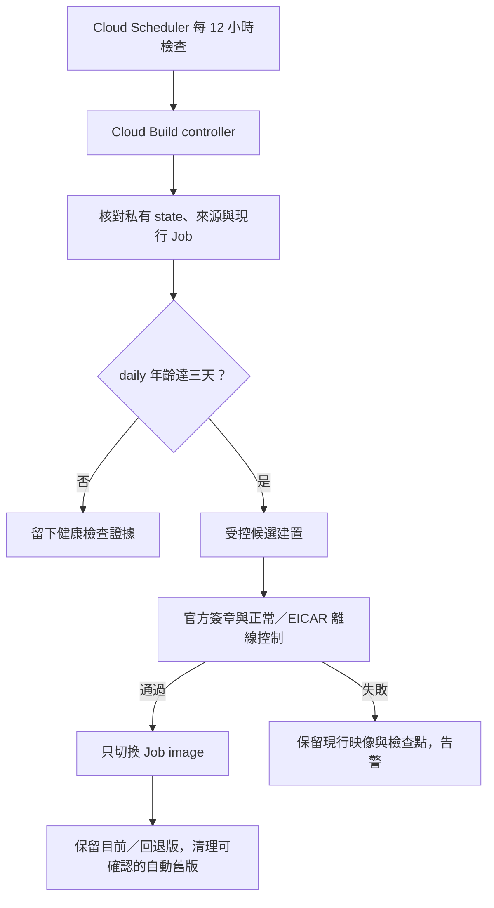

# 自動簽章病毒庫更新（P0-12）

更新日期：2026-11-09（Asia/Taipei）。這項維護讓雲端 demo 定期檢查 ClamAV daily 資料庫年齡，
在過期前建立帶有新簽章資料庫的候選映像，通過控制後才切換既有 Job。
它沿用[人工更新與回退流程](cloud-demo-operations.md#2-更新病毒庫及保留回退版本)，不新增檔案分析功能。

**程式與本機測試交付、雲端資源安裝、排程首次成功、通知送達及費用驗證分開記錄。**
GitHub 推送不會自動建立資源或啟用排程。P0-12 必須取得實際排程與失敗通知證據後才能完整結案；
已完成的 F-11 三個固定案例不需要為安裝本工具而重複上傳。
本批程式與測試結果見[本機交付紀錄](milestones/2026-11-04-automatic-database-updates.json)。

## 更新如何進行

Cloud Scheduler 在 **03:23、15:23 UTC** 觸發健康檢查，台北時間為每天 **11:23、23:23**。
每次檢查都確認已核准來源、現行 Job 設定、映像與私有操作狀態；符合更新門檻才提交新映像建置。



| 項目 | 本批限制 |
| --- | --- |
| 健康檢查 | 每 12 小時；不呼叫分析 Job 的 execute API |
| 建置門檻 | 目前 daily 的產生時間已達三天 |
| 候選資料庫 | daily 年齡不超過兩天，日期不得比現行資料庫倒退 |
| 發布控制 | main／daily／bytecode 官方簽章，以及正常檔／EICAR 的 ClamAV 和 YARA 控制皆通過 |
| 新建置意圖 | 每 UTC 日最多一次、每 UTC 月最多 12 次；失敗與回應不確定也保守占用名額 |
| 自動持有版本 | 達四個仍無法安全清理時停止新建置並告警 |
| 分析執行額度 | 不呼叫 `run.jobs.run`，不消耗 demo 掃描 execution 額度 |
| 執行期防毒 gate | 原有七天限制保留，從 daily 的產生時間起算 |

健康檢查的 controller 本身也是 Cloud Build 工作，與受控候選建置分開計費。
建置成功不會直接略過離線控制；排程 HTTP 呼叫成功只代表 controller 已被受理。
更新失敗時保留現行映像，但長期失敗仍會讓它的資料庫超過七天，ClamAV 因而回報 partial；
保留舊版不能取代失敗告警與後續處理。

## 核准來源與手動部署

排程使用私有 GCS 中已核准的 `git archive` bundle，固定 object generation、來源 commit 與檔案指紋。
安裝時，worker／backend 建置輸入必須符合已成功人工更新的 maintenance checkpoint；
排程不自動追蹤 GitHub main，也不藉由病毒庫更新發布尚未部署的新功能。

每次檢查都要求目前 Job 的映像及設定等於已登記版本。人工部署新功能造成差異時，自動流程停止，
避免下一次更新把程式切回舊來源。重新核准來源必須是明確的維護操作，不能直接修改遠端 state 的 phase 或 image。

人工部署前先暫停排程，確認既有 controller 與候選建置已收尾，保留檢查點後再進行部署。
Cloud Run 的讀取、image 更新及 Registry 刪除不是同一筆原子交易；
本工具的 lease 與設定核對不能保證與任意同時執行的 Console／gcloud 修改互相隔離。

## 私有狀態與斷線接續

狀態、Job 基準、離線控制與映像所有權 ledger 存在私有 regional GCS bucket。
不把完整 Job、環境變數、Secret 參照、capability 或操作 checkpoint 放到 GitHub logs／公開附件。
一般輸出只包含安全摘要、已確認的 digest、版本與固定錯誤碼。

每次可能改變遠端資源前，先以 GCS generation 比較並寫入 pending 意圖。
回應遺失時，下次只查詢該意圖的結果，不直接再次提交相同建置、更新或刪除。
因此 Cloud Shell、controller 或網路中斷後，必須保留原 campaign 與 state。

維護鎖沒有依時間自動失效的偷鎖流程。只有確認上一個 controller 的 Cloud Build 已為 terminal，
才可用 generation 條件接管；owner 狀態未知時停止。這避免舊程序暫停後恢復，與新程序同時送出更新。
目前版、回退版與不確定 candidate 都受保護；candidate 與目前 digest 相同時保留真正的上一個回退指標。

## 映像與建置來源保留

清理只涵蓋私有 ledger 明確記錄為本自動流程產生的 `full-worker@完整digest`。
現有所有 tags 都必須屬於該 digest 已登記的精確 release；新增的人工 tag 或未知 metadata 會阻止刪除。

刪除前後均重新盤點完整 repository 與 Cloud Run 引用，包括所有區域的 Job、Service、revision 和未完成 execution。
目前版、上一個回退版、進行中／回應不確定的 candidate、任何仍被引用的映像，以及 OCI index／未知 media type 都不得刪除。
`engine-poc`、dispatcher 與原有手動映像保持原狀；沒有 tag 或日期較舊都不是單獨的刪除理由。

每次最多處理 20 個固定 digest。刪除結果不確定時，若下一次盤點仍看到該版本就停止，
不自動再送一次 delete。只有明確確認已不存在後才記錄完成並接續。
版本數下降、映像顯示大小相加與實際帳單節省仍分開核對。

新 operations bucket 位於 `us-central1`，只有 `build-sources/` 前綴使用七天 lifecycle。
核准 bundle、目前／回退 checkpoint 與全域 state 不套用這個盲目到期規則。
新 bucket 的 soft delete／versioning 設定需隨安裝計畫檢視；不修改既有來源 bucket 的保留規則。
生命週期處理及 Registry layer 回收有延遲，不能把發出刪除請求當成立即停止計費。

## 身分與安裝邊界

安裝計畫使用三個獨立服務帳號，OAuth 憑證由 Google 平台提供；不建立 service account 私鑰。

| 身分 | 用途 |
| --- | --- |
| `malscan-v2-db-scheduler` | 只提交 controller Build，並以指定 updater 身分執行 |
| `malscan-v2-db-updater` | 讀取必要 metadata、管理私有 state、提交受控建置、更新指定 Job image 及清理允許的版本 |
| `malscan-v2-db-builder` | 讀取建置來源、發布指定 Registry repository 的候選映像及寫入建置日誌 |

Job 的 image 更新權限限於 `malscan-v2-static-demo`；引用盤點另需全專案的 Cloud Run metadata 讀取權。
updater 的 actAs 限指定 builder 與既有 static-demo runtime 身分；scheduler 的 actAs 限 updater。
不授予專案 Owner／Editor、Secret payload 讀取或分析 execution 權限。
Registry 的 IAM 刪除權限只能授予 repository 範圍，完整 package／digest 邊界另由程式與私有 ledger 限制。

安裝分成三個階段：

1. `prepare` 只在 Cloud Shell HOME 的新私人目錄產生 reviewable plan 與來源 bundle，核對現有 maintenance checkpoint，不變更雲端。
2. `apply` 才建立計畫中的 bucket、scoped IAM、日誌 metrics、預設停用的 alert policies 和暫停的 Scheduler；全域 state 初始為 disabled。
3. `enable` 是另一個明確動作，核對初始健康檢查與通知設定後才啟用。建立或修改政策後立即執行新 tick，確認第一個健康資料點。

操作計畫、原始 Job 基準與 provisioning journal 保持在 repository 外，權限為私人檔案。
重新連線時使用同一 plan／journal，不建立第二套同名資源或清除 pending 意圖。

## Cloud Shell 安裝步驟

這是現有 `malscan-v2-poc` 的維護安裝，不是重新部署前端、Worker 或分析 Job。
`prepare` 不建立雲端資源；`apply` 會建立計畫所列資源並可能產生費用。
先完成以下停用狀態的讀回，再啟用排程。不需要重新上傳三個 F-11 樣本。

### 1. 保存本輪來源並核對人工檢查點

第一次執行以下區塊；若來源已保存，直接使用既有路徑，避免另建一批。

```bash
(
  set -e
  umask 077
  if [ -e "$HOME/malscan-v2-auto-update-source-path.txt" ]; then
    echo '來源已保存；請使用既有路徑接續，不重新 clone。'
    exit 1
  fi
  V2_AUTO_SOURCE=$(mktemp -d "$HOME/malscan-v2-auto-update.XXXXXX")
  git clone --quiet --branch main --single-branch \
    https://github.com/daluoter/Mal-Scan-Worker.git "$V2_AUTO_SOURCE"
  cd "$V2_AUTO_SOURCE"
  test -f deployment/cloud-run/setup-auto-update.py
  git rev-parse HEAD
  pwd > "$HOME/malscan-v2-auto-update-source-path.txt"

  python3 deployment/cloud-run/maintain-demo.py status \
    --state-dir "$(cat "$HOME/malscan-v2-f11-followup-state-path.txt")"
)
```

人工 checkpoint 必須為 `promoted`，且目前映像仍是該版本。
之前僅因 `client-version` metadata 差異停在 `promotion_pending` 的那批，使用新版 `status` 讀回即可核對，
不要重新 submit 或 promote。若仍未成為 `promoted`，先保留輸出處理差異，不能直接改 state。
這裡的 marker 指向已驗收 F-11 的人工更新；若你之後另有人工更新，應選用對應的成功 checkpoint。

### 2. 選取通知管道

在 Google Cloud Console 的 **Monitoring → Alerting → Edit notification channels**
建立或確認自己的 Email／其他通知管道，完成它要求的驗證。
接著在 Cloud Shell 列出名稱與狀態；這段只讀 metadata，不輸出 channel labels 中的 email address、憑證或 Token。
`displayName` 是你自訂的辨識名稱，請留在私人操作紀錄中：

```bash
python3 - <<'PY_CHANNELS'
import json
import subprocess
import urllib.request

token = subprocess.run(
    ['gcloud', 'auth', 'print-access-token', '--project=malscan-v2-poc', '--quiet'],
    capture_output=True, text=True, check=True,
).stdout.strip()
url = 'https://monitoring.googleapis.com/v3/projects/malscan-v2-poc/notificationChannels?pageSize=100'
request = urllib.request.Request(url, headers={'Authorization': 'Bearer ' + token})
with urllib.request.urlopen(request, timeout=30) as response:
    result = json.load(response)
for channel in result.get('notificationChannels', []):
    print(json.dumps({key: channel.get(key) for key in
        ('name', 'displayName', 'type', 'enabled', 'verificationStatus')}, ensure_ascii=False))
if result.get('nextPageToken'):
    print('清單超過一頁；請在 Console 核對所需管道，勿把本頁視為完整清單。')
PY_CHANNELS
```

保存要使用的 `name`，例如 `projects/malscan-v2-poc/notificationChannels/數字ID`。
下一段會在你的 Shell 讀取此名稱；不需把通知設定或任何秘密上傳 GitHub。

### 3. 產生私人安裝計畫

```bash
(
  set -e
  umask 077
  cd "$(cat "$HOME/malscan-v2-auto-update-source-path.txt")"
  if [ -e "$HOME/malscan-v2-auto-update-plan-path.txt" ]; then
    echo '計畫已保存；請使用原 plan 接續，不重新 prepare。'
    exit 1
  fi
  read -r -p 'Monitoring notification channel 完整 name: ' V2_AUTO_CHANNEL
  V2_AUTO_PLAN_ROOT=$(mktemp -d "$HOME/malscan-v2-auto-plan.XXXXXX")
  python3 deployment/cloud-run/setup-auto-update.py prepare \
    --maintenance-state-dir "$(cat "$HOME/malscan-v2-f11-followup-state-path.txt")" \
    --notification-channel "$V2_AUTO_CHANNEL" \
    --output "$V2_AUTO_PLAN_ROOT/plan"
  printf '%s\n' "$V2_AUTO_PLAN_ROOT/plan" > "$HOME/malscan-v2-auto-update-plan-path.txt"
)
```

`prepare` 固定本輪 commit，檢查 `git archive` 中的實際 worker／backend 建置輸入與人工 checkpoint 一致，
並拒絕髒工作樹、缺少控制程式、來源差異或不安全 archive。若失敗，不要繞過 fingerprint 或手改計畫。
預設新 bucket 是 `malscan-v2-poc-db-operations`；若它已被其他用途占用，先檢查原因再選擇其他本專案名稱，
不能把不明既有 bucket 納入自動清理。

在 Cloud Shell 本機開啟 plan 目錄內的 `plan.json`，核對 bucket、IAM、排程、來源及通知管道。
檔案也含私人 Job 基準與 Secret 參照，**不要整份貼到聊天或提交 GitHub**。

### 4. 安裝，確認仍停用

```bash
(
  set -e
  cd "$(cat "$HOME/malscan-v2-auto-update-source-path.txt")"
  python3 deployment/cloud-run/setup-auto-update.py apply \
    --plan-dir "$(cat "$HOME/malscan-v2-auto-update-plan-path.txt")"
)
```

預期 `phase: installed_paused`、`scheduler_state: PAUSED`、`automatic_updates_enabled: false`。
安裝會核對必要的 Google managed service-agent 權限；缺少時停止，不會以 Owner／Editor 補救。
若固定錯誤碼為 `setup_managed_service_agent_role_missing`，先確認已啟用 Scheduler／Cloud Build API，
再建立這兩項 Google 管理身分並只恢復它們各自的 service-agent role：

```bash
(
  set -e
  V2_AUTO_PROJECT_NUMBER=$(gcloud projects describe malscan-v2-poc --format='value(projectNumber)')
  for V2_AUTO_SERVICE in cloudscheduler cloudbuild; do
    gcloud beta services identity create \
      --service="$V2_AUTO_SERVICE.googleapis.com" --project=malscan-v2-poc
    gcloud projects add-iam-policy-binding malscan-v2-poc \
      --member="serviceAccount:service-$V2_AUTO_PROJECT_NUMBER@gcp-sa-$V2_AUTO_SERVICE.iam.gserviceaccount.com" \
      --role="roles/$V2_AUTO_SERVICE.serviceAgent" --condition=None
  done
)
```

這些 role 只授予對應的 **Google managed service agent**，不能授予一般使用者或三個自訂維護帳號。
完成後用原 plan 接續 `apply`，不重新 prepare。
不明寫入結果先以同一 plan 重新讀回；已存在且符合計畫的操作不重送。
若顯示 `pending_write_requires_reconciliation`，保留原 journal 處理，不能刪除 pending 後重試。

#### 建立後讀回尚未就緒時

11/4 首次安裝曾在 `account:scheduler` 留下 `pending`／`provider_accepted: true`，
回報 `setup_write_not_verified`；之後使用者讀回的 email、displayName、description 全部符合預期。
[Google IAM 官方文件](https://cloud.google.com/iam/docs/service-accounts-create)說明，
新服務帳號的讀取採最終一致性，可能要 60 秒以上才可見。原版只立即讀回一次，因此會過早停止。

修補版對新建立與既有 pending 操作只重查結果，退避等待合計最多 60 秒，不重送建立／修改請求；
若仍無法驗證，就保留原意圖停止。已 confirmed 資源的設定差異仍立即阻擋，不套用等待或自動修復。
讀回驗證失敗摘要會附 `operation` 與 `readback_observed`，不輸出 provider body 或計畫內的值。

若使用 `c907187` 建立的舊 plan，僅更新本機安裝工具後，從原 plan 接續第四步即可。
不要重新 prepare、刪除帳號、改 journal 或重新打包 `source.tar.gz`；bundle 仍固定原核准 commit，
已取得的 GCS generation 也保持不變。卡在第一個帳號的這次安裝尚未走到 bundle 上傳。
帳號讀回修補沒有更改 controller、建置範本、核准來源或 IAM 範圍，舊 plan 可沿用。
若等待後仍出現錯誤，提供新的安全摘要即可，保留原檔案供後續讀回核對。

### 5. 執行一次停用狀態的健康檢查

```bash
(
  set -e
  cd "$(cat "$HOME/malscan-v2-auto-update-source-path.txt")"
  python3 deployment/cloud-run/setup-auto-update.py probe \
    --plan-dir "$(cat "$HOME/malscan-v2-auto-update-plan-path.txt")"
)
```

這會建立一個 controller Build，僅核對已登記來源、目前 Job 與病毒庫，不建候選映像、不更新 Job、不刪映像。
保存回傳 `build_id`，以它查詢；不要因 `WORKING` 再建立一批：

```bash
read -r -p '上一段 probe 的 build_id: ' V2_AUTO_PROBE_BUILD_ID
gcloud builds describe "$V2_AUTO_PROBE_BUILD_ID" \
  --project=malscan-v2-poc --region=us-central1 --format='yaml(id,status)'
```

成功後查安全摘要：

```bash
(
  set -e
  cd "$(cat "$HOME/malscan-v2-auto-update-source-path.txt")"
  python3 deployment/cloud-run/setup-auto-update.py status \
    --plan-dir "$(cat "$HOME/malscan-v2-auto-update-plan-path.txt")"
  python3 deployment/cloud-run/auto_update.py status \
    --bucket malscan-v2-poc-db-operations
)
```

應看到最近的 `last_healthy_at`、`last_status: paused_healthy`，排程及更新仍停用。
若 `probe` 提交回應遺失，重新使用同一 plan 執行 `probe` 會查唯一 request tag；找不到或不唯一就停止，
不會再提交一次。若已核准病毒庫超過七天，必須先走人工更新並取得新 checkpoint，不能跳過 freshness gate。

#### 舊版 probe 在 Python 啟動前失敗

11/4 首次停用安裝已完成，但第一個 probe Build 在啟動容器時回報
`exec: "python3": executable file not found in $PATH`。controller 尚未開始，因此健康紀錄為 null。
精簡 Cloud SDK 映像刻意不把 bundled Python 加入 PATH；它的 Python 預設 SSL trust store 也沒有 CA。
修補版固定已實測的 SDK image digest、Python 絕對路徑及 SDK certifi CA 路徑，保留 TLS 驗證。
CI 也直接執行該容器，檢查 Python、可信 CA、gcloud 與 controller imports，避免只靠 API mocks。

已安裝的舊 plan 不必重建。先更新本機來源至這次 runtime 修補版本，再執行：

```bash
(
  set -e
  cd "$(cat "$HOME/malscan-v2-auto-update-source-path.txt")"
  python3 deployment/cloud-run/setup-auto-update.py repair-runtime \
    --plan-dir "$(cat "$HOME/malscan-v2-auto-update-plan-path.txt")"
)
```

此命令要求 Scheduler 為 PAUSED、state 為 disabled、沒有 active campaign／lease，
且原 probe 的來源、身分、request 與 terminal FAILURE 都匹配該次 Python 啟動失敗。
它先保存修補意圖，只 PATCH 既有 Scheduler 的 controller request body，讀回成功後才啟用私人 runtime override。
原 plan、bundle、GCS generation、目前／回退映像與 IAM 範圍都保留；原失敗 probe 另存歷史紀錄。
Scheduler API 的讀回與 PATCH 不是和 Console 編輯的原子交易，修補期間不要另行修改該排程。

預期 `scope: controller_runtime_repair`、`status: confirmed`、`probe_submitted: false`。
若回應不明，下次同一命令只讀回核對，不重送 PATCH；不要清除 pending 或手改計畫來重試。
修補成功後，使用同一 plan 再執行本節的 `probe`，取得**一個新的 Build ID**。
重複 `repair-runtime` 不會清除這個新 probe；重複 `probe` 只回傳既有 ID，不額外提交。

再依上述方式查新 Build 與 `status`，確認 `paused_healthy` 才進入第六步。
`source_commit` 仍可為原核准的 `c907187`：這次修補的是執行環境，沒有重新發布應用程式。

### 6. 明確啟用並核對新健康點

只有上一段檢查成功且決定啟用維護時，才執行：

```bash
(
  set -e
  cd "$(cat "$HOME/malscan-v2-auto-update-source-path.txt")"
  python3 deployment/cloud-run/setup-auto-update.py enable \
    --plan-dir "$(cat "$HOME/malscan-v2-auto-update-plan-path.txt")"
)
```

工具會再次核對安裝資源，啟用兩個 alert policies、更新私有 enabled state、恢復 Scheduler，
並要求一個啟用後的新 tick。首次 tick 若已達三天更新門檻，便可能進行候選建置與 image-only 切換。
`activation_submitted` 只代表觸發已受理，不能當成自動更新或通知已驗收。
等該次 controller 完成，再用第五段的 `status` 查摘要，並到 Monitoring 的 Metrics Explorer 確認
`logging.googleapis.com/user/malscan_db_update_healthy` 有**啟用政策之後**的新資料點。
通知管道送達、失敗事件與後續到期更新仍依下方清單記錄。

Cloud Shell 中斷後，只需回到已保存來源，以原 `--plan-dir` 執行 `status`；
不重建 bucket、服務帳號、通知政策或原始計畫。若有 pending，保留狀態及固定錯誤碼繼續查核。

#### 讀回 Monitoring 設定與資料點

11/4 已取得 `ENABLED`、`automatic_updates_enabled: true` 與啟用後新健康紀錄，
最後確認的時間為台北 16:45:18。這證明 controller 已寫回私有檢查點，Monitoring 的實際資料點另行核對。
更新本機工具來源至含 `inspect-auto-update.py` 的版本後，可重複執行以下只讀檢查：

```bash
(
  set -e
  umask 077
  cd "$(cat "$HOME/malscan-v2-auto-update-source-path.txt")"
  V2_AUTO_OBSERVATION="$HOME/malscan-v2-auto-observability-$(date -u +%Y%m%dT%H%M%SZ).json"
  python3 deployment/cloud-run/inspect-auto-update.py \
    --plan-dir "$(cat "$HOME/malscan-v2-auto-update-plan-path.txt")" \
    --output "$V2_AUTO_OBSERVATION"
)
```

工具只 GET 狀態、Scheduler、兩個 log metrics、兩個 alert policies、通知管道 metadata，
以及最近健康 controller Build 的 time series。它不更動原 plan／state、寫入測試日誌、寄信或提交 Build。
報告只包含審查後的 metadata；不含通知 labels／email、Token、provider body 或原始 Job。
`--output` 只建立新私人檔案，不覆寫既有檔案，也拒絕寫入 source checkout。

重點欄位如下：

| 欄位 | 意義 |
| --- | --- |
| `read_complete: true` | 本次讀取與分頁完成；controller state 在讀取期間沒有換 generation |
| `enabled_monitoring_metadata_matches_plan: true` | 來源與已啟用的 Scheduler／metrics／policies／通知管道 metadata 匹配核准設定 |
| `healthy_metric_ingestion_verified: true` | 啟用後的新健康檢查點，已找到對應 Build ID 的 Monitoring 正整數資料點 |
| `healthy_metric.post_activation_point_observed: false` | 查詢完成，但尚未讀到符合範圍的正值；可稍後重查同一工具 |
| `healthy_metric.post_activation_point_observed: null` | 未能完成查詢或驗證；看 `errors` 的固定錯誤碼，不能當成「沒有資料點」 |
| `notification_delivery_verified: false` | 工具不宣稱郵件已送達，需另留實際收信證據 |

time series 鎖定同專案、`resource.type=build` 與私有 state 中最近健康的 Build ID；
查詢區間為啟用時間之後、觀察時間以前，最多三頁／3,000 點。
讀取失敗、分頁未完成、來源不符或同期 state 變動時回報未知／不完整，不以 checkpoint 代替 Monitoring 資料。
`scheduler.last_attempt_at` 未區分手動觸發與 cron，不單憑它結案真正排程驗收。

Email 的 verification status 缺少／null 可是該類管道不需驗證，仍需另確認實際告警收信。
Google 沒有通用的 Email `testNotification` API；受控通知測試會另留意圖、事件與收信證據，
本只讀工具不觸發它。健康點可見、通知送達、真正病毒庫更新與費用是四份不同證據。

#### 受控失敗告警與收信測試

11/5 15:41 的使用者報告已確認 Monitoring 設定與健康資料點；下一項是現有失敗政策的實際通知。
以下測試會新增**一個刻意失敗的 Cloud Build**，使用原核准 source bundle 及既有 controller 身分。
它把 owner 參數設為明確無效的 UUID，使 controller 在任何 state／Job／Registry 操作之前停止，
輸出 `lease_owner_invalid`／`MALSCAN_DB_UPDATE_FAILURE`。這個早停路徑已在原 `c907187` 來源與實際 SDK 容器中驗證。
測試目的是讓現有 `MalScan database update failed` 政策觀察到一次受控失敗事件。

這會使用一次 Cloud Build 工作與其建置額度，無論是否仍在免費額度內都應納入成本觀察；
不消耗 demo 的 Cloud Run 掃描 execution 額度，也不建立新的分析映像。
單一事件不保證立即寄達，可能有資料入帳與政策評估延遲；開啟／關閉事件也可能各有通知。
測試的 queue TTL 與執行 timeout 各為五分鐘，開始前距下一次排程需超過 30 分鐘。
請選擇沒有其他人工維護的時段，讓受控測試與真正的失敗事件容易區分。

更新本機工具後，先產生與檢閱私人測試摘要：

```bash
(
  set -e
  cd "$(cat "$HOME/malscan-v2-auto-update-source-path.txt")"
  python3 deployment/cloud-run/test-auto-update-notification.py prepare \
    --plan-dir "$(cat "$HOME/malscan-v2-auto-update-plan-path.txt")"
)
```

`prepare` 會檢查來源 archive 的六個 controller 相依檔案與已驗證版本逐 byte 相同，
GCS bundle generation、現有 Monitoring 設定與健康點、enabled／idle／無 lease 都需通過。
它只建立 plan 目錄中的私人 `notification-test.json`，原 plan、bundle 與主操作 journal 保留。
摘要的 `expected_build_status: FAILURE` 是本測試的預期結果。

檢閱後提交這一次受控事件：

```bash
(
  set -e
  cd "$(cat "$HOME/malscan-v2-auto-update-source-path.txt")"
  python3 deployment/cloud-run/test-auto-update-notification.py submit \
    --plan-dir "$(cat "$HOME/malscan-v2-auto-update-plan-path.txt")"
)
```

提交前先保存意圖與唯一 request tag；回應遺失時以相同 sidecar 查回 Build，不再建立一筆。
之後使用以下命令讀回，保留原紀錄：

```bash
(
  set -e
  cd "$(cat "$HOME/malscan-v2-auto-update-source-path.txt")"
  python3 deployment/cloud-run/test-auto-update-notification.py status \
    --plan-dir "$(cat "$HOME/malscan-v2-auto-update-plan-path.txt")"
)
```

工具核對精確 request／來源／身分及 Build ID，只有 `FAILURE` 加上正確早停 marker 才標記
`failure_marker_verified: true`，其他失敗不算通過。Cloud Logging 的 `entries:list` 是 POST 型式的讀取操作。
報告不輸出原始日誌、provider body、通知 labels 或 email；`image_pointers_match_pre_submit`
只比較私有 state 記錄的目前／回退指標，不代替一次獨立的 Cloud Run Job 交易讀回。

收到通知時，核對政策名稱 **MalScan database update failed** 與本次測試時間。
實際收到對應告警後，才執行以下明確的人工確認：

```bash
(
  set -e
  cd "$(cat "$HOME/malscan-v2-auto-update-source-path.txt")"
  python3 deployment/cloud-run/test-auto-update-notification.py received \
    --plan-dir "$(cat "$HOME/malscan-v2-auto-update-plan-path.txt")" \
    --policy-title 'MalScan database update failed'
)
```

marker 存在不會自動變成收信成功；`received` 保存的是使用者確認時間與證據類型，沒有讀取你的信箱。
若尚未收到通知，繼續查同一個測試的狀態及 Monitoring 事件，不能以重送 Build 取代診斷。
此測試驗證早停失敗的告警鏈；更新中斷的回復、真正 cron 更新及費用仍依各自證據驗收。

若舊版回報 `notification_marker_read_incomplete`，先更新本機工具，再使用原 plan 執行 `status`。
Cloud Logging 的空白頁仍可能包含 `nextPageToken`，表示搜尋尚未結束；工具現會沿相同查詢條件讀取最多五頁、每頁最多 100 筆，
並將時間範圍限制在已保存的提交時間前五分鐘至本次查詢時間後五分鐘，容許時鐘誤差。
精確符合本次 Build 與早停原因的 marker 可直接作為正面證據；只有分頁完整結束才回報本次未觀察到 marker。
分頁循環、格式異常或達到讀取上限仍視為未確認，不輸出原始日誌或分頁代碼。
此修正沿用既有 `notification-test.json` 與 Build，不需重新 `prepare` 或 `submit`。

11/6 使用者已讀回本次 Build 的 `failure_verified` 與正確早停 marker，並確認收到告警信，
此限定通知測試已通過；執行上方 `received` 可把人工確認保存至私人紀錄。
同次結果的 `image_pointers_match_pre_submit: false` 只表示目前或回退指標有變動，
需核對真正排程更新或其他變更，不能據此推定測試改動了 Job、更新成功或需要回退。
接續使用以下只讀查詢，最後一行只列出 live Job 的映像，不輸出環境變數：

```bash
(
  set -e
  cd "$(cat "$HOME/malscan-v2-auto-update-source-path.txt")"
  python3 deployment/cloud-run/inspect-auto-update.py \
    --plan-dir "$(cat "$HOME/malscan-v2-auto-update-plan-path.txt")"
  gcloud run jobs describe malscan-v2-static-demo \
    --project=malscan-v2-poc \
    --region=us-central1 \
    --format='value(spec.template.spec.template.spec.containers[0].image)'
)
```

上述預設查詢的通知送達與真正更新旗標固定為 false，該模式只核對設定與健康點，
不讀取收信 sidecar；這不會推翻本次使用者的收信驗收。此查詢也不單獨證明 daily 版本、完整 controls 或真正 cron 來源。
新指標與 live Job 仍需比對，簽章更新與復原、費用各自保留驗收條件。

11/6 後續使用者已取得 `delivery_recorded`；人工確認保存於台北 12:27:38，與實際到信時間分開。
新目前映像 `493fd6bd…bfc21c` 與 live Job 相符，前一個目前版 `4a018a2a…10b263` 已成為回退版。
提供的恢復通知畫面顯示失敗指標為 0、事件 recovered；這不等於更新中斷復原或實際映像回退。

#### 核對目前發布的建置與簽章證據

更新至含 `--current-release` 的本機工具後，可沿用原 plan，一次讀回目前發布的建置與離線控制證據：

```bash
(
  set -e
  cd "$(cat "$HOME/malscan-v2-auto-update-source-path.txt")"
  python3 deployment/cloud-run/inspect-auto-update.py \
    --plan-dir "$(cat "$HOME/malscan-v2-auto-update-plan-path.txt")" \
    --current-release
)
```

此選項核對私人 promoted 檢查點、live Job Ready 與完整設定、精確候選 Build 的身分／結果／步驟，
再讀該 Build 實際輸出的 engine controls，與保存的報告比對。只輸出已驗證的版本、digest、時間及布林結果，
不輸出 Job 環境變數、原始日誌、通知 labels 或私有設定。查詢前後的 state generation 必須一致。

`cloud_release_evidence_verified: true` 表示目前發布、Build 與 controls 的證據鏈核對通過；
`current_release.daily_database` 顯示 daily 版本／建立時間，四項控制與三個資料庫簽章分開列出。
候選映像的來源是 operations bucket 的 `build-sources/`，controller 則使用原固定 bundle，兩者不能混為同一個物件。
來源檢查核對登記指紋、builder 身分與 staging 範圍，並未重新下載來源 archive 計算內容指紋。

此選項只讀取既有資源，不提交 Build、執行掃描、切換映像或更新 state／journal。
它保留 `real_scheduled_refresh_verified: false`：真正 cron 的派送來源仍需當次 Scheduler／controller 的因果證據，
不能只拿後續 `healthy_no_update_due` 的健康 Build 當作先前更新的證明。

#### 目前發布已通過；接續核對 cron 來源

11/6 台北 13:03 的使用者讀回已取得 `cloud_release_evidence_verified: true`。
發布 `db-20261105T152451Z-88ed6053b825` 已 promoted，Build `2f77a00d-44bf-4911-871f-8a0406ed4181`
於台北 11/5 23:25:03 至 23:27:33 成功完成；daily 已從 `28172` 更新至 `28174`，
四項離線控制與三個資料庫簽章均通過，新映像及 Job 完整設定、回退指標已核對，見[本次紀錄](milestones/2026-11-06-signed-database-refresh-acceptance.json)。
本段已驗證目前發布的更新證據；cron／手動觸發的來源仍需當次事件，不重建或重跑掃描。

以下三個只讀查詢限制在台北 11/5 **23:20–23:35**（UTC 15:20–15:35）：
先讀 Scheduler 執行紀錄，再找當次 controller Build，最後讀同時段人工 `RunJob` 的 Admin Activity。
格式只輸出已選取的時間、狀態及工作識別，不包含呼叫者 email、原始 payload、URL 或 debugInfo。

```bash
(
  set -e
  gcloud logging read \
    'resource.type="cloud_scheduler_job" AND resource.labels.project_id="malscan-v2-poc" AND resource.labels.location="us-central1" AND resource.labels.job_id="malscan-v2-database-updates" AND timestamp>="2026-11-05T15:20:00Z" AND timestamp<"2026-11-05T15:35:00Z"' \
    --project=malscan-v2-poc \
    --freshness=30d --order=asc --limit=100 \
    --format='json(timestamp,jsonPayload.jobName,jsonPayload.scheduledTime,jsonPayload.status,httpRequest.status)'

  gcloud builds list \
    --project=malscan-v2-poc --region=us-central1 \
    --filter='tags=malscan-db-controller AND createTime>="2026-11-05T15:20:00Z" AND createTime<"2026-11-05T15:35:00Z"' \
    --sort-by=createTime --limit=20 \
    --format='json(id,status,createTime,startTime,finishTime)'

  gcloud logging read \
    'log_id("cloudaudit.googleapis.com/activity") AND protoPayload.serviceName="cloudscheduler.googleapis.com" AND protoPayload.methodName=~"CloudScheduler[.]RunJob$" AND (protoPayload.resourceName="projects/malscan-v2-poc/locations/us-central1/jobs/malscan-v2-database-updates" OR protoPayload.request.name="projects/malscan-v2-poc/locations/us-central1/jobs/malscan-v2-database-updates") AND timestamp>="2026-11-05T15:20:00Z" AND timestamp<"2026-11-05T15:35:00Z"' \
    --project=malscan-v2-poc \
    --freshness=30d --order=asc --limit=100 \
    --format='json(timestamp,protoPayload.methodName,protoPayload.resourceName,protoPayload.status.code)'
)
```

`scheduledTime` 可能缺少，不填造推定值。沒有人工 `RunJob` 紀錄只表示該查詢未觀察到，
不能單獨當作 cron 證明；需一起核對排程事件、controller 身分／固定來源與更新輸出。
結果若達 `--limit` 或查詢失敗，仍不是完整清單。後續 `78b18eed…` 的健康 Build 不是當次更新 parent。
[Scheduler 執行日誌](https://cloud.google.com/scheduler/docs/viewing-logs)與
[RunJob 稽核分類](https://cloud.google.com/scheduler/docs/audit-logging)分開讀回；本步不觸發 `RunJob`。

上述查詢已取得使用者結果：Scheduler `scheduledTime` 為台北 11/5 23:23:03.416282，HTTP 200，
同時段只有一筆 controller `32fc839a-aa93-4146-b6de-cb3dee8803c5`，建立時間距排程時間約 0.099 秒。
controller 成功執行至 23:29:44，涵蓋前述發布準備與候選建置，該發布已另讀回 promoted；人工 `RunJob` 查詢為空。
結合先前已匹配的 Scheduler 設定、發布與 controls，接受為**一次排程更新的限定案例驗收**，不需重複這一輪查詢或建置。
這是紀錄交叉核對，沒有取得直接 request ID 連結，也未額外重讀此 parent 的完整身分／來源與 `updated` marker。
空白稽核只是輔助證據；既有觀測報告的 cron 旗標保留其原始範圍，未因本人工驗收而改寫工具或舊報告。

更新中斷復原工具與[分階段手冊](auto-update-recovery-rehearsal.md)現已交付：先執行只讀 `prepare`，再依最新摘要指定時間監看自然更新。
私人紀錄綁定當次 controller、candidate Build、campaign 與目前／回退 digest；以保留原 campaign、接續同一候選、沒有多餘建置或重複切換為驗收條件。
舊的 11/8 時段已過，不能直接照舊日期取消工作；實際雲端復原證據仍待執行。
本次成功更新與告警恢復尚未演練這個情境；映像清理／保留期與實際用量費用持續另列，P0-12 維持進行中。

### 7. 人工部署前暫停

```bash
(
  set -e
  cd "$(cat "$HOME/malscan-v2-auto-update-source-path.txt")"
  python3 deployment/cloud-run/setup-auto-update.py pause \
    --plan-dir "$(cat "$HOME/malscan-v2-auto-update-plan-path.txt")"
)
```

這會暫停 Scheduler、將私有更新 state 設為 disabled，並停用兩個維護告警，避免有意停機造成缺心跳通知。
它不取消已在執行中的 controller；若摘要 `controller_in_flight: true`，先等該 controller／候選建置結束，
查核 `active` checkpoint，再做人工變更。不能只因排程顯示 PAUSED 就同時修改 Job。
僅暫停而未改動來源或 Job 時，可重新執行 `enable`；它會重新啟用政策並要求新的健康點。

**本批沒有跨功能版本的自動 adoption 指令。** 人工發布新 worker／backend 後，原 plan 的來源與 Job 核對會停止；
需要依新成功 maintenance checkpoint 做另一輪核准與私有狀態遷移，保留原所有權與回退紀錄。
不要用刪除 operations bucket、覆寫 state 或另建空 ledger 的方式重裝。下一次功能發布應將這個遷移納入同一批部署。

## 告警如何驗證

`malscan_db_update_failure` 計數 controller 的固定失敗 marker，正值持續 60 秒後開啟事件，
稀疏計數缺資料時視為 inactive，讓之後新的失敗能重新產生事件。
`malscan_db_update_healthy` 計數已驗證的健康 tick；23 小時未出現新點則告警。
兩者在判定前跨 build ID 加總，不讓每個已結束的歷史 Build 都變成獨立缺心跳事件。

23 小時窗搭配每 12 小時檢查。Cloud Monitoring 的 metric absence 最長為 23.5 小時；
不使用不合法的 48 小時 absence 設定，也不在每日一次檢查前就提前告警。
建立或修改 absence policy 後，必須先收到新的資料點才開始有意義地判定缺點；舊日誌不會自動回補新 metric。

安裝需要同專案既有且啟用的通知管道，格式為
`projects/malscan-v2-poc/notificationChannels/數字ID`。請在 Cloud Monitoring 選取自己的通知管道並確認收信，
不需要提供郵件密碼、Token、service account key 或把通知管道的私有設定貼到聊天。

controller 在 Python 開始前就發生來源下載、身分或程序啟動失敗時，可能沒有失敗 marker；
已建立第一個資料點的缺心跳告警補上這個缺口。故意暫停維護也要考慮缺心跳政策，不能輸出假的健康 marker 來隱藏停機。
Cloud Build 成功、Scheduler HTTP 受理、政策存在與通知實際送達是不同證據。

## 本批的雲端驗收清單

以下各項尚未取得雲端證據時，P0-12 維持進行中：

- 安裝計畫的 bucket 確為私有、`us-central1`、符合前綴 lifecycle，IAM 不含額外分析／Secret payload 權限。
- disabled／paused 初始狀態經實際讀回，第一個 controller 只做健康核對，沒有非預期 image 變更。
- 啟用後的新健康點可在 metric 看到，通知管道收得到測試或可控失敗的實際通知，事件可關閉並在新失敗時重開。
- 真正到期門檻的一次排程更新：官方簽章、正常／EICAR 控制、digest readback、Job image-only 切換與目前／回退指標均一致。
- 建置失敗或回應遺失會保留現行版與原 campaign；重連不額外提交 execution、建置、更新或不確定刪除。
- 清理只移除已登記且不再引用的自動版本，其他 package、手動版、目前版與回退版仍在。
- 後續用量與帳單核對 Cloud Scheduler、controller／候選 Cloud Build、Registry、GCS、Logging／Monitoring 等費用。

私下保存 plan、來源 commit／fingerprint、bundle generation、操作 journal、Build IDs、digest、控制摘要、Scheduler／metric／policy 狀態及帳單。
公開里程碑僅提交審查後的 metadata 與 hash。P0-06 DO 清理、P0-11 真實回退、P0-14 長期成本、
P0-15 Cloudflare 用量及 P0-18 每筆分析工作的保留期不因本工具程式交付而結案。

## 費用與持續維護

每月 12 次限制涵蓋新候選建置意圖，另外仍有每天兩次 controller Build 及首次驗證檢查。
排程、建置、映像、來源物件與觀測資料都有各自的額度與計費方式；帳戶共用免費額度也可能已被其他專案使用。
本工具不承諾零費用，預算警告不能取代支出上限；每月應檢視實際帳單與儲存讀數。

目前官方價格頁列出 Cloud Build default pool `e2-standard-2` 每帳單帳戶每月前 2,500 build-minutes 的促銷免費額度，
Cloud Scheduler 每帳單帳戶前三個 jobs 的免費額度；條件可能調整，也不涵蓋所有映像與來源儲存成本。
見 [Cloud Build pricing](https://cloud.google.com/build/pricing) 與
[Cloud Scheduler pricing](https://cloud.google.com/scheduler/pricing)。計畫使用新的 regional bucket，
既有 multi-region `malscan-v2-poc_cloudbuild` 的物件、soft delete 及費用不受這批修改。

自動 ledger 的版本上限可避免排程無限新增本流程的映像，但不代表原有手動映像或 Cloud Build 舊來源已清完。
所有權 ledger 另有 1,000 筆紀錄的硬上限；達上限會停止並告警，歷史已刪紀錄尚未自動壓縮。
保留與成本的完整工作仍列 P0-07／P0-14；排程首次成功也不代替長期成本觀察。

官方參考：[Cloud Monitoring absence](https://cloud.google.com/monitoring/alerts/metric-absence)、
[Logging metrics](https://cloud.google.com/logging/docs/logs-based-metrics)、
[Artifact Registry 映像管理](https://cloud.google.com/artifact-registry/docs/docker/manage-images)。
