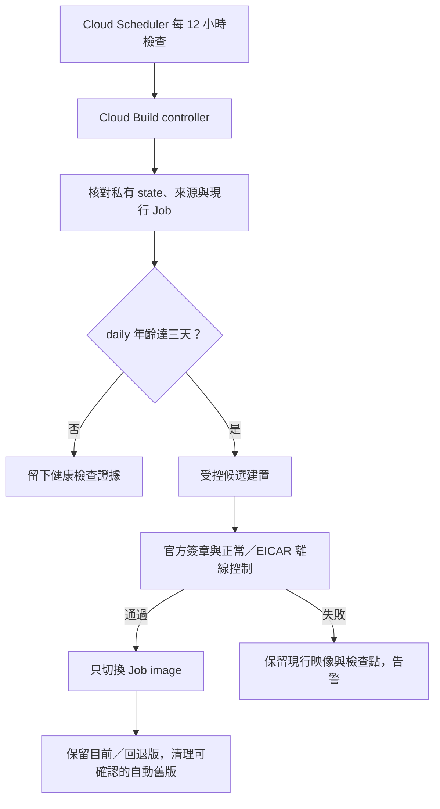

# 自動簽章病毒庫更新（P0-12）

更新日期：2026-11-04（Asia/Taipei）。這項維護讓雲端 demo 定期檢查 ClamAV daily 資料庫年齡，
在過期前建立帶有新簽章資料庫的候選映像，通過控制後才切換既有 Job。
它沿用[人工更新與回退流程](cloud-demo-operations.md#2-更新病毒庫及保留回退版本)，不新增檔案分析功能。

**程式與本機測試交付、雲端資源安裝、排程首次成功、通知送達及費用驗證分開記錄。**
GitHub 推送不會自動建立資源或啟用排程。P0-12 必須取得實際排程與失敗通知證據後才能完整結案；
已完成的 F-11 三個固定案例不需要為安裝本工具而重複上傳。
本批程式與測試結果見[本機交付紀錄](milestones/2026-11-04-automatic-database-updates.json)。

## 更新如何進行

Cloud Scheduler 在 **03:23、15:23 UTC** 觸發健康檢查，台北時間為每天 **11:23、23:23**。
每次檢查都確認已核准來源、現行 Job 設定、映像與私有操作狀態；符合更新門檻才提交新映像建置。



| 項目 | 本批限制 |
| --- | --- |
| 健康檢查 | 每 12 小時；不呼叫分析 Job 的 execute API |
| 建置門檻 | 目前 daily 的產生時間已達三天 |
| 候選資料庫 | daily 年齡不超過兩天，日期不得比現行資料庫倒退 |
| 發布控制 | main／daily／bytecode 官方簽章，以及正常檔／EICAR 的 ClamAV 和 YARA 控制皆通過 |
| 新建置意圖 | 每 UTC 日最多一次、每 UTC 月最多 12 次；失敗與回應不確定也保守占用名額 |
| 自動持有版本 | 達四個仍無法安全清理時停止新建置並告警 |
| 分析執行額度 | 不呼叫 `run.jobs.run`，不消耗 demo 掃描 execution 額度 |
| 執行期防毒 gate | 原有七天限制保留，從 daily 的產生時間起算 |

健康檢查的 controller 本身也是 Cloud Build 工作，與受控候選建置分開計費。
建置成功不會直接略過離線控制；排程 HTTP 呼叫成功只代表 controller 已被受理。
更新失敗時保留現行映像，但長期失敗仍會讓它的資料庫超過七天，ClamAV 因而回報 partial；
保留舊版不能取代失敗告警與後續處理。

## 核准來源與手動部署

排程使用私有 GCS 中已核准的 `git archive` bundle，固定 object generation、來源 commit 與檔案指紋。
安裝時，worker／backend 建置輸入必須符合已成功人工更新的 maintenance checkpoint；
排程不自動追蹤 GitHub main，也不藉由病毒庫更新發布尚未部署的新功能。

每次檢查都要求目前 Job 的映像及設定等於已登記版本。人工部署新功能造成差異時，自動流程停止，
避免下一次更新把程式切回舊來源。重新核准來源必須是明確的維護操作，不能直接修改遠端 state 的 phase 或 image。

人工部署前先暫停排程，確認既有 controller 與候選建置已收尾，保留檢查點後再進行部署。
Cloud Run 的讀取、image 更新及 Registry 刪除不是同一筆原子交易；
本工具的 lease 與設定核對不能保證與任意同時執行的 Console／gcloud 修改互相隔離。

## 私有狀態與斷線接續

狀態、Job 基準、離線控制與映像所有權 ledger 存在私有 regional GCS bucket。
不把完整 Job、環境變數、Secret 參照、capability 或操作 checkpoint 放到 GitHub logs／公開附件。
一般輸出只包含安全摘要、已確認的 digest、版本與固定錯誤碼。

每次可能改變遠端資源前，先以 GCS generation 比較並寫入 pending 意圖。
回應遺失時，下次只查詢該意圖的結果，不直接再次提交相同建置、更新或刪除。
因此 Cloud Shell、controller 或網路中斷後，必須保留原 campaign 與 state。

維護鎖沒有依時間自動失效的偷鎖流程。只有確認上一個 controller 的 Cloud Build 已為 terminal，
才可用 generation 條件接管；owner 狀態未知時停止。這避免舊程序暫停後恢復，與新程序同時送出更新。
目前版、回退版與不確定 candidate 都受保護；candidate 與目前 digest 相同時保留真正的上一個回退指標。

## 映像與建置來源保留

清理只涵蓋私有 ledger 明確記錄為本自動流程產生的 `full-worker@完整digest`。
現有所有 tags 都必須屬於該 digest 已登記的精確 release；新增的人工 tag 或未知 metadata 會阻止刪除。

刪除前後均重新盤點完整 repository 與 Cloud Run 引用，包括所有區域的 Job、Service、revision 和未完成 execution。
目前版、上一個回退版、進行中／回應不確定的 candidate、任何仍被引用的映像，以及 OCI index／未知 media type 都不得刪除。
`engine-poc`、dispatcher 與原有手動映像保持原狀；沒有 tag 或日期較舊都不是單獨的刪除理由。

每次最多處理 20 個固定 digest。刪除結果不確定時，若下一次盤點仍看到該版本就停止，
不自動再送一次 delete。只有明確確認已不存在後才記錄完成並接續。
版本數下降、映像顯示大小相加與實際帳單節省仍分開核對。

新 operations bucket 位於 `us-central1`，只有 `build-sources/` 前綴使用七天 lifecycle。
核准 bundle、目前／回退 checkpoint 與全域 state 不套用這個盲目到期規則。
新 bucket 的 soft delete／versioning 設定需隨安裝計畫檢視；不修改既有來源 bucket 的保留規則。
生命週期處理及 Registry layer 回收有延遲，不能把發出刪除請求當成立即停止計費。

## 身分與安裝邊界

安裝計畫使用三個獨立服務帳號，OAuth 憑證由 Google 平台提供；不建立 service account 私鑰。

| 身分 | 用途 |
| --- | --- |
| `malscan-v2-db-scheduler` | 只提交 controller Build，並以指定 updater 身分執行 |
| `malscan-v2-db-updater` | 讀取必要 metadata、管理私有 state、提交受控建置、更新指定 Job image 及清理允許的版本 |
| `malscan-v2-db-builder` | 讀取建置來源、發布指定 Registry repository 的候選映像及寫入建置日誌 |

Job 的 image 更新權限限於 `malscan-v2-static-demo`；引用盤點另需全專案的 Cloud Run metadata 讀取權。
updater 的 actAs 限指定 builder 與既有 static-demo runtime 身分；scheduler 的 actAs 限 updater。
不授予專案 Owner／Editor、Secret payload 讀取或分析 execution 權限。
Registry 的 IAM 刪除權限只能授予 repository 範圍，完整 package／digest 邊界另由程式與私有 ledger 限制。

安裝分成三個階段：

1. `prepare` 只在 Cloud Shell HOME 的新私人目錄產生 reviewable plan 與來源 bundle，核對現有 maintenance checkpoint，不變更雲端。
2. `apply` 才建立計畫中的 bucket、scoped IAM、日誌 metrics、預設停用的 alert policies 和暫停的 Scheduler；全域 state 初始為 disabled。
3. `enable` 是另一個明確動作，核對初始健康檢查與通知設定後才啟用。建立或修改政策後立即執行新 tick，確認第一個健康資料點。

操作計畫、原始 Job 基準與 provisioning journal 保持在 repository 外，權限為私人檔案。
重新連線時使用同一 plan／journal，不建立第二套同名資源或清除 pending 意圖。

## Cloud Shell 安裝步驟

這是現有 `malscan-v2-poc` 的維護安裝，不是重新部署前端、Worker 或分析 Job。
`prepare` 不建立雲端資源；`apply` 會建立計畫所列資源並可能產生費用。
先完成以下停用狀態的讀回，再啟用排程。不需要重新上傳三個 F-11 樣本。

### 1. 保存本輪來源並核對人工檢查點

第一次執行以下區塊；若來源已保存，直接使用既有路徑，避免另建一批。

```bash
(
  set -e
  umask 077
  if [ -e "$HOME/malscan-v2-auto-update-source-path.txt" ]; then
    echo '來源已保存；請使用既有路徑接續，不重新 clone。'
    exit 1
  fi
  V2_AUTO_SOURCE=$(mktemp -d "$HOME/malscan-v2-auto-update.XXXXXX")
  git clone --quiet --branch main --single-branch \
    https://github.com/daluoter/Mal-Scan-Worker.git "$V2_AUTO_SOURCE"
  cd "$V2_AUTO_SOURCE"
  test -f deployment/cloud-run/setup-auto-update.py
  git rev-parse HEAD
  pwd > "$HOME/malscan-v2-auto-update-source-path.txt"

  python3 deployment/cloud-run/maintain-demo.py status \
    --state-dir "$(cat "$HOME/malscan-v2-f11-followup-state-path.txt")"
)
```

人工 checkpoint 必須為 `promoted`，且目前映像仍是該版本。
之前僅因 `client-version` metadata 差異停在 `promotion_pending` 的那批，使用新版 `status` 讀回即可核對，
不要重新 submit 或 promote。若仍未成為 `promoted`，先保留輸出處理差異，不能直接改 state。
這裡的 marker 指向已驗收 F-11 的人工更新；若你之後另有人工更新，應選用對應的成功 checkpoint。

### 2. 選取通知管道

在 Google Cloud Console 的 **Monitoring → Alerting → Edit notification channels**
建立或確認自己的 Email／其他通知管道，完成它要求的驗證。
接著在 Cloud Shell 列出名稱與狀態；這段只讀 metadata，不輸出 channel labels 中的 email address、憑證或 Token。
`displayName` 是你自訂的辨識名稱，請留在私人操作紀錄中：

```bash
python3 - <<'PY_CHANNELS'
import json
import subprocess
import urllib.request

token = subprocess.run(
    ['gcloud', 'auth', 'print-access-token', '--project=malscan-v2-poc', '--quiet'],
    capture_output=True, text=True, check=True,
).stdout.strip()
url = 'https://monitoring.googleapis.com/v3/projects/malscan-v2-poc/notificationChannels?pageSize=100'
request = urllib.request.Request(url, headers={'Authorization': 'Bearer ' + token})
with urllib.request.urlopen(request, timeout=30) as response:
    result = json.load(response)
for channel in result.get('notificationChannels', []):
    print(json.dumps({key: channel.get(key) for key in
        ('name', 'displayName', 'type', 'enabled', 'verificationStatus')}, ensure_ascii=False))
if result.get('nextPageToken'):
    print('清單超過一頁；請在 Console 核對所需管道，勿把本頁視為完整清單。')
PY_CHANNELS
```

保存要使用的 `name`，例如 `projects/malscan-v2-poc/notificationChannels/數字ID`。
下一段會在你的 Shell 讀取此名稱；不需把通知設定或任何秘密上傳 GitHub。

### 3. 產生私人安裝計畫

```bash
(
  set -e
  umask 077
  cd "$(cat "$HOME/malscan-v2-auto-update-source-path.txt")"
  if [ -e "$HOME/malscan-v2-auto-update-plan-path.txt" ]; then
    echo '計畫已保存；請使用原 plan 接續，不重新 prepare。'
    exit 1
  fi
  read -r -p 'Monitoring notification channel 完整 name: ' V2_AUTO_CHANNEL
  V2_AUTO_PLAN_ROOT=$(mktemp -d "$HOME/malscan-v2-auto-plan.XXXXXX")
  python3 deployment/cloud-run/setup-auto-update.py prepare \
    --maintenance-state-dir "$(cat "$HOME/malscan-v2-f11-followup-state-path.txt")" \
    --notification-channel "$V2_AUTO_CHANNEL" \
    --output "$V2_AUTO_PLAN_ROOT/plan"
  printf '%s\n' "$V2_AUTO_PLAN_ROOT/plan" > "$HOME/malscan-v2-auto-update-plan-path.txt"
)
```

`prepare` 固定本輪 commit，檢查 `git archive` 中的實際 worker／backend 建置輸入與人工 checkpoint 一致，
並拒絕髒工作樹、缺少控制程式、來源差異或不安全 archive。若失敗，不要繞過 fingerprint 或手改計畫。
預設新 bucket 是 `malscan-v2-poc-db-operations`；若它已被其他用途占用，先檢查原因再選擇其他本專案名稱，
不能把不明既有 bucket 納入自動清理。

在 Cloud Shell 本機開啟 plan 目錄內的 `plan.json`，核對 bucket、IAM、排程、來源及通知管道。
檔案也含私人 Job 基準與 Secret 參照，**不要整份貼到聊天或提交 GitHub**。

### 4. 安裝，確認仍停用

```bash
(
  set -e
  cd "$(cat "$HOME/malscan-v2-auto-update-source-path.txt")"
  python3 deployment/cloud-run/setup-auto-update.py apply \
    --plan-dir "$(cat "$HOME/malscan-v2-auto-update-plan-path.txt")"
)
```

預期 `phase: installed_paused`、`scheduler_state: PAUSED`、`automatic_updates_enabled: false`。
安裝會核對必要的 Google managed service-agent 權限；缺少時停止，不會以 Owner／Editor 補救。
若固定錯誤碼為 `setup_managed_service_agent_role_missing`，先確認已啟用 Scheduler／Cloud Build API，
再建立這兩項 Google 管理身分並只恢復它們各自的 service-agent role：

```bash
(
  set -e
  V2_AUTO_PROJECT_NUMBER=$(gcloud projects describe malscan-v2-poc --format='value(projectNumber)')
  for V2_AUTO_SERVICE in cloudscheduler cloudbuild; do
    gcloud beta services identity create \
      --service="$V2_AUTO_SERVICE.googleapis.com" --project=malscan-v2-poc
    gcloud projects add-iam-policy-binding malscan-v2-poc \
      --member="serviceAccount:service-$V2_AUTO_PROJECT_NUMBER@gcp-sa-$V2_AUTO_SERVICE.iam.gserviceaccount.com" \
      --role="roles/$V2_AUTO_SERVICE.serviceAgent" --condition=None
  done
)
```

這些 role 只授予對應的 **Google managed service agent**，不能授予一般使用者或三個自訂維護帳號。
完成後用原 plan 接續 `apply`，不重新 prepare。
不明寫入結果先以同一 plan 重新讀回；已存在且符合計畫的操作不重送。
若顯示 `pending_write_requires_reconciliation`，保留原 journal 處理，不能刪除 pending 後重試。

#### 建立後讀回尚未就緒時

11/4 首次安裝曾在 `account:scheduler` 留下 `pending`／`provider_accepted: true`，
回報 `setup_write_not_verified`；之後使用者讀回的 email、displayName、description 全部符合預期。
[Google IAM 官方文件](https://cloud.google.com/iam/docs/service-accounts-create)說明，
新服務帳號的讀取採最終一致性，可能要 60 秒以上才可見。原版只立即讀回一次，因此會過早停止。

修補版對新建立與既有 pending 操作只重查結果，退避等待合計最多 60 秒，不重送建立／修改請求；
若仍無法驗證，就保留原意圖停止。已 confirmed 資源的設定差異仍立即阻擋，不套用等待或自動修復。
讀回驗證失敗摘要會附 `operation` 與 `readback_observed`，不輸出 provider body 或計畫內的值。

若使用 `c907187` 建立的舊 plan，僅更新本機安裝工具後，從原 plan 接續第四步即可。
不要重新 prepare、刪除帳號、改 journal 或重新打包 `source.tar.gz`；bundle 仍固定原核准 commit，
已取得的 GCS generation 也保持不變。卡在第一個帳號的這次安裝尚未走到 bundle 上傳。
本次修補沒有更改 controller、建置範本、核准來源或 IAM 範圍，舊 plan 可沿用。
若等待後仍出現錯誤，提供新的安全摘要即可，保留原檔案供後續讀回核對。

### 5. 執行一次停用狀態的健康檢查

```bash
(
  set -e
  cd "$(cat "$HOME/malscan-v2-auto-update-source-path.txt")"
  python3 deployment/cloud-run/setup-auto-update.py probe \
    --plan-dir "$(cat "$HOME/malscan-v2-auto-update-plan-path.txt")"
)
```

這會建立一個 controller Build，僅核對已登記來源、目前 Job 與病毒庫，不建候選映像、不更新 Job、不刪映像。
保存回傳 `build_id`，以它查詢；不要因 `WORKING` 再建立一批：

```bash
read -r -p '上一段 probe 的 build_id: ' V2_AUTO_PROBE_BUILD_ID
gcloud builds describe "$V2_AUTO_PROBE_BUILD_ID" \
  --project=malscan-v2-poc --region=us-central1 --format='yaml(id,status)'
```

成功後查安全摘要：

```bash
(
  set -e
  cd "$(cat "$HOME/malscan-v2-auto-update-source-path.txt")"
  python3 deployment/cloud-run/setup-auto-update.py status \
    --plan-dir "$(cat "$HOME/malscan-v2-auto-update-plan-path.txt")"
  python3 deployment/cloud-run/auto_update.py status \
    --bucket malscan-v2-poc-db-operations
)
```

應看到最近的 `last_healthy_at`、`last_status: paused_healthy`，排程及更新仍停用。
若 `probe` 提交回應遺失，重新使用同一 plan 執行 `probe` 會查唯一 request tag；找不到或不唯一就停止，
不會再提交一次。若已核准病毒庫超過七天，必須先走人工更新並取得新 checkpoint，不能跳過 freshness gate。

### 6. 明確啟用並核對新健康點

只有上一段檢查成功且決定啟用維護時，才執行：

```bash
(
  set -e
  cd "$(cat "$HOME/malscan-v2-auto-update-source-path.txt")"
  python3 deployment/cloud-run/setup-auto-update.py enable \
    --plan-dir "$(cat "$HOME/malscan-v2-auto-update-plan-path.txt")"
)
```

工具會再次核對安裝資源，啟用兩個 alert policies、更新私有 enabled state、恢復 Scheduler，
並要求一個啟用後的新 tick。首次 tick 若已達三天更新門檻，便可能進行候選建置與 image-only 切換。
`activation_submitted` 只代表觸發已受理，不能當成自動更新或通知已驗收。
等該次 controller 完成，再用第五段的 `status` 查摘要，並到 Monitoring 的 Metrics Explorer 確認
`logging.googleapis.com/user/malscan_db_update_healthy` 有**啟用政策之後**的新資料點。
通知管道送達、失敗事件與後續到期更新仍依下方清單記錄。

Cloud Shell 中斷後，只需回到已保存來源，以原 `--plan-dir` 執行 `status`；
不重建 bucket、服務帳號、通知政策或原始計畫。若有 pending，保留狀態及固定錯誤碼繼續查核。

### 7. 人工部署前暫停

```bash
(
  set -e
  cd "$(cat "$HOME/malscan-v2-auto-update-source-path.txt")"
  python3 deployment/cloud-run/setup-auto-update.py pause \
    --plan-dir "$(cat "$HOME/malscan-v2-auto-update-plan-path.txt")"
)
```

這會暫停 Scheduler、將私有更新 state 設為 disabled，並停用兩個維護告警，避免有意停機造成缺心跳通知。
它不取消已在執行中的 controller；若摘要 `controller_in_flight: true`，先等該 controller／候選建置結束，
查核 `active` checkpoint，再做人工變更。不能只因排程顯示 PAUSED 就同時修改 Job。
僅暫停而未改動來源或 Job 時，可重新執行 `enable`；它會重新啟用政策並要求新的健康點。

**本批沒有跨功能版本的自動 adoption 指令。** 人工發布新 worker／backend 後，原 plan 的來源與 Job 核對會停止；
需要依新成功 maintenance checkpoint 做另一輪核准與私有狀態遷移，保留原所有權與回退紀錄。
不要用刪除 operations bucket、覆寫 state 或另建空 ledger 的方式重裝。下一次功能發布應將這個遷移納入同一批部署。

## 告警如何驗證

`malscan_db_update_failure` 計數 controller 的固定失敗 marker，正值持續 60 秒後開啟事件，
稀疏計數缺資料時視為 inactive，讓之後新的失敗能重新產生事件。
`malscan_db_update_healthy` 計數已驗證的健康 tick；23 小時未出現新點則告警。
兩者在判定前跨 build ID 加總，不讓每個已結束的歷史 Build 都變成獨立缺心跳事件。

23 小時窗搭配每 12 小時檢查。Cloud Monitoring 的 metric absence 最長為 23.5 小時；
不使用不合法的 48 小時 absence 設定，也不在每日一次檢查前就提前告警。
建立或修改 absence policy 後，必須先收到新的資料點才開始有意義地判定缺點；舊日誌不會自動回補新 metric。

安裝需要同專案既有且啟用的通知管道，格式為
`projects/malscan-v2-poc/notificationChannels/數字ID`。請在 Cloud Monitoring 選取自己的通知管道並確認收信，
不需要提供郵件密碼、Token、service account key 或把通知管道的私有設定貼到聊天。

controller 在 Python 開始前就發生來源下載、身分或程序啟動失敗時，可能沒有失敗 marker；
已建立第一個資料點的缺心跳告警補上這個缺口。故意暫停維護也要考慮缺心跳政策，不能輸出假的健康 marker 來隱藏停機。
Cloud Build 成功、Scheduler HTTP 受理、政策存在與通知實際送達是不同證據。

## 本批的雲端驗收清單

以下各項尚未取得雲端證據時，P0-12 維持進行中：

- 安裝計畫的 bucket 確為私有、`us-central1`、符合前綴 lifecycle，IAM 不含額外分析／Secret payload 權限。
- disabled／paused 初始狀態經實際讀回，第一個 controller 只做健康核對，沒有非預期 image 變更。
- 啟用後的新健康點可在 metric 看到，通知管道收得到測試或可控失敗的實際通知，事件可關閉並在新失敗時重開。
- 真正到期門檻的一次排程更新：官方簽章、正常／EICAR 控制、digest readback、Job image-only 切換與目前／回退指標均一致。
- 建置失敗或回應遺失會保留現行版與原 campaign；重連不額外提交 execution、建置、更新或不確定刪除。
- 清理只移除已登記且不再引用的自動版本，其他 package、手動版、目前版與回退版仍在。
- 後續用量與帳單核對 Cloud Scheduler、controller／候選 Cloud Build、Registry、GCS、Logging／Monitoring 等費用。

私下保存 plan、來源 commit／fingerprint、bundle generation、操作 journal、Build IDs、digest、控制摘要、Scheduler／metric／policy 狀態及帳單。
公開里程碑僅提交審查後的 metadata 與 hash。P0-06 DO 清理、P0-11 真實回退、P0-14 長期成本、
P0-15 Cloudflare 用量及 P0-18 每筆分析工作的保留期不因本工具程式交付而結案。

## 費用與持續維護

每月 12 次限制涵蓋新候選建置意圖，另外仍有每天兩次 controller Build 及首次驗證檢查。
排程、建置、映像、來源物件與觀測資料都有各自的額度與計費方式；帳戶共用免費額度也可能已被其他專案使用。
本工具不承諾零費用，預算警告不能取代支出上限；每月應檢視實際帳單與儲存讀數。

目前官方價格頁列出 Cloud Build default pool `e2-standard-2` 每帳單帳戶每月前 2,500 build-minutes 的促銷免費額度，
Cloud Scheduler 每帳單帳戶前三個 jobs 的免費額度；條件可能調整，也不涵蓋所有映像與來源儲存成本。
見 [Cloud Build pricing](https://cloud.google.com/build/pricing) 與
[Cloud Scheduler pricing](https://cloud.google.com/scheduler/pricing)。計畫使用新的 regional bucket，
既有 multi-region `malscan-v2-poc_cloudbuild` 的物件、soft delete 及費用不受這批修改。

自動 ledger 的版本上限可避免排程無限新增本流程的映像，但不代表原有手動映像或 Cloud Build 舊來源已清完。
所有權 ledger 另有 1,000 筆紀錄的硬上限；達上限會停止並告警，歷史已刪紀錄尚未自動壓縮。
保留與成本的完整工作仍列 P0-07／P0-14；排程首次成功也不代替長期成本觀察。

官方參考：[Cloud Monitoring absence](https://cloud.google.com/monitoring/alerts/metric-absence)、
[Logging metrics](https://cloud.google.com/logging/docs/logs-based-metrics)、
[Artifact Registry 映像管理](https://cloud.google.com/artifact-registry/docs/docker/manage-images)。
