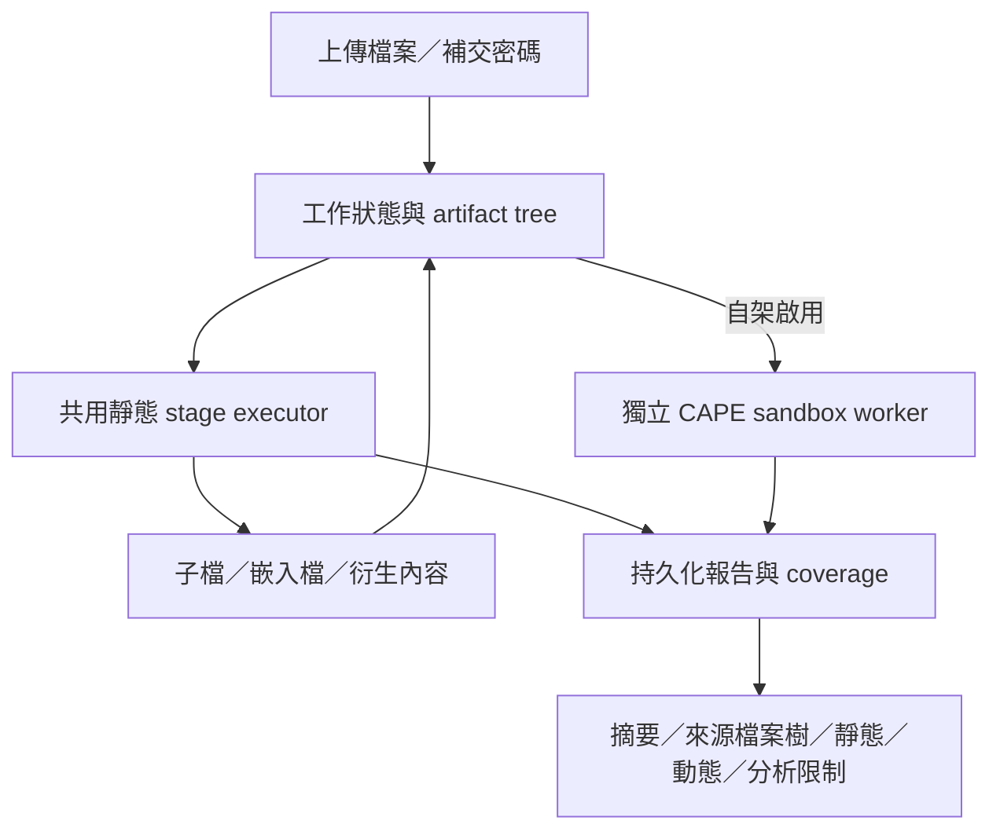

# MalScanWorker v2 架構與實作範圍

本文件依已核准的產品架構草案更新。產品核心是可追溯、能說明覆蓋範圍的靜態分析；免費雲端是 demo 部署模式，自架可啟用動態分析。以下區分已落地的程式與仍需外部環境驗收的部分。

## 同一分析核心，不同部署 adapter

| 模式 | 執行與儲存 | 能力及限制 |
| --- | --- | --- |
| 自架靜態 | Compose／PostgreSQL／MinIO／RabbitMQ | 延用現有 upload、job、artifact、report API；預設不啟用動態分析 |
| 單次靜態 batch | Python portable runner；本機或 S3／R2 adapter | 同一 stage executor 分析 root 與衍生檔，持久化報告與已簽名 checkpoint；不需資料庫或 broker |
| 自架靜態＋動態 | 自架靜態版＋獨立 sandbox worker＋既有 CAPE | 靜態報告可先閱讀，真實動態結果後續回填；需先配置分析 guest／snapshot／隔離網路 |
| 雲端 demo | Cloudflare Worker／SQLite Durable Objects／private R2＋Cloud Run Jobs | 靜態限定；來源與結果分 bucket，簽名 control／status／checkpoint；已完成一份良性檔的正式網頁端到端驗收 |

共用 executor 在 `worker/src/malscan_worker/pipeline.py`；`StageContext` 的可選 service ports 讓提取與子工作提交使用不同 adapter。自架 worker 使用既有資料庫／queue adapter，`worker/src/malscan_worker/runtime/` 提供 portable batch、store、manifest、dispatch 與 checkpoint。兩種入口重用相同分析 stages，不以先前只驗 ClamAV／YARA 的 PoC runner 代替正式 pipeline。

artifact 是來源與報告的單位，execution 是執行／恢復單位。portable runner 在有預算限制的同一 root batch 內遞迴分析，不預設每個子檔啟動一個 Cloud Run Job。已完成的良性檔雲端執行可作為第一個時間基準；複雜檔案的 CPU、記憶體與實際帳單仍須實測。

## 完整靜態分析的契約

「完整」表示在已宣告支援範圍提供可核對的結果與未完成原因，不表示保證偵測所有威脅或解密所有格式。[支援矩陣](analysis-support.md)列出目前 PE／Office／PDF／LNK／scripts、ZIP／7z／RAR／TAR／gzip／bzip2 的實際能力、外部依賴與限制。限定 PDF 及現代 OOXML 支援補交密碼、建立解密子檔與續跑，詳見 [PDF](pdf-password.md) 與 [Office](office-password.md)；舊式 Office 二進位加密不支援。ISO 仍為 stub，ELF／Mach-O／郵件／APK 專用深度分析尚未提供。

每個原檔、解壓檔、嵌入檔及衍生內容保留來源關係。相同內容在不同路徑仍保留出現位置；同名 ZIP／7z entries 不互相覆寫。風險證據分直接與繼承來源，與執行覆蓋分開處理。

| 契約 | 首輪實作 |
| --- | --- |
| Stage coverage | 無 YARA 規則、工具失敗、parser fallback、大小／深度／預算限制有明確狀態與原因；可取得時記錄工具／規則版本 |
| Root 累計預算 | PostgreSQL row-lock adapter 與 portable in-memory adapter 共用 files／expanded bytes 契約；reservation high-water 讓 immutable output 重試不重複扣額 |
| 強制終止提取 | Linux process group 邊界處理 archive／Office 提取；timeout／取消會停止 parser 及同組外部 helper，不依賴 thread 外的表面 timeout |
| 密碼恢復 | 補交維持 artifact／root／ancestor 上下文，保留已完成 stage checkpoint；密碼不進報告或 checkpoint。錯誤次數耗盡仍保留外層證據 |
| 工作隔離 | Job advisory lock 序列化重複 delivery；execution attempt fence 阻擋舊執行覆寫新成果；確認 retry 發送後才 ack 原訊息 |
| 可閱讀部分報告 | API／UI 接受已保存的 static／partial report，顯示 descendant／dynamic 各自狀態，後續更新同一報告 |

Root 的 files／bytes 跨整棵樹累計；deadline 是每次 execution attempt 的時間窗。密碼等待與另一輪 resume 開新時間窗，保留原額度，不延長已執行的舊 attempt。展開 bytes 不代表第三方 parser heap 已受限，仍需容器／worker 記憶體上限。

報告使用 `report_schema_version=mswr-report-v3` 與 `analysis.schema_version=mswr-analysis-v1`。`analysis.static` 記錄狀態及 stage coverage；`analysis.dynamic` 獨立記錄 disabled／queued／running／complete／failed／unavailable／mock 等結果。沒有證據時保留 unknown，不把 skipped 或零命中一概稱為完整掃描。

## 動態分析：真實結果與恢復

`SANDBOX_ENABLED=false`、`SANDBOX_PROVIDER=capev2` 是預設。配置可用的 CAPE／guest 後，可執行 [`scripts/enable-sandbox.sh`](../scripts/enable-sandbox.sh)：先 GET 官方 `/apiv2/machines/list/` 檢查 API 存取與未鎖定的登記 guest，成功才啟用 workers。此檢查不開 VM、不提交樣本，也不驗證 guest boot 或 snapshot 還原；Compose 不代建 CAPE 基礎設施。

正式 provider、queue、timeout、circuit 或 report 失敗保留 failed／unavailable，不改用 mock。mock 僅供明確開發選擇，有 synthetic 標記、`executed=false`，不參與真實動態風險評分。已正規化的 CAPE 結果保留 process／file／registry／network／dropped-file 等欄位及可取得的 artifact refs；API error JSON 即使 HTTP 200 也不當成可下載 PCAP／截圖。

提交前保存 `submitting`，取得 task id 後保存 `running`；已知 task 的重送只 poll／取報告。endpoint fingerprint 防止把舊 task id 用在不同 CAPE host。若提交結果不確定、缺少 task id，回報 `provider_submission_unknown`、`reconcile_required=true` 並停止自動重送。這避免盲目再次 detonate，不宣稱外部 CAPE 與資料庫 exactly once。

CAPE 若一次回傳多個 task id，先保存完整 `task_ids`，再回報 `provider_multiple_tasks`／unavailable／reconcile_required；恢復時也不只 poll 第一個或重新 POST。多動態 task 聚合尚未提供，不能將第一個 task 的結果稱為全部完成。

動態掉落檔再送靜態核心、選擇適用 artifact／guest 的進階 policy，以及更完整沙箱 provider 生態，仍是後續擴充；目前不宣稱所有子檔均已進動態分析。

## Demo 控制層與費用邊界

[Cloudflare 控制層](../deployment/cloudflare/README.md)使用 SQLite Durable Objects 保存工作狀態與派送身份，以 private R2 保存來源／成果；[Cloud Run 入口](../deployment/cloud-run/README.md)呼叫同一 portable 核心。來源檔、manifest、control、report／status、checkpoint 依工作及 attempt 身份綁定，結果不依賴容器暫存磁碟或 Cloud Logging。

前端部署於 Cloudflare Pages，正式 origin 為 `https://malscan-v2-demo.pages.dev`；只允許這個 origin 的瀏覽器 CORS，單次 Pages 預覽網址不在允許範圍。Worker 與公開 HTTPS dispatcher 以短效、用途分離的 HMAC 驗證；dispatcher 取得附掛 Google 服務帳戶的 metadata 短期 token，並在呼叫固定 Job 前領取 Durable Object 的一次性 claim。無 Google 服務帳戶私鑰，`constraints/iam.disableServiceAccountKeyCreation` 保持啟用。claim 後的未知結果不會自動重送。公開服務仍可能因無效請求而產生費用。

Cloudflare Browser Integrity 曾拒絕 Python 預設的 `urllib` client；dispatcher 現在明確設定 `User-Agent: MalScanWorker-dispatcher/1.0`。此修正識別呼叫程式，不放寬 CORS 或伺服器憑證驗證。

目前 demo 部署目標的硬限制為原檔 20,000,000 bytes、展開檔數 20、展開 bytes 100,000,000、深度 3、執行預算 840 秒；Cloud Run task timeout 900 秒、2 CPU／4 GiB。月 execution 預算 40 次，包含 resume 及結果不確定的派送；實際部署細節以 deployment 文件為準。這些是成本與資源限制，不代表由舊 PoC 推算出零費用。

免費額度是 demo 目標。帳戶共享配額、簽章資料更新、Artifact Registry、Secret Manager、日誌、儲存與實際冷啟動均可能影響帳單。自架版可依資源配置提高限制，產品能力不由 demo 額度決定。

## 驗收與仍待完成的外部確認

本輪已加入共用核心／報告契約、實際 ZIP／7z／巢狀密碼與預算、子程序終止、真 PostgreSQL 累計／fence、portable local／S3 adapters、CAPE 本機 HTTP fixture／task 恢復與啟用腳本等測試。測試不等於全面格式相容性或 live provider 驗收。

2026-10-14（Asia/Taipei）已確認第一份正式網頁良性檔 `hello.txt` 完成 Pages → Worker／Durable Object → keyless dispatcher → Cloud Run Job → R2 → 報告下載，`job_status=done`、`report_complete=true`、static complete、dynamic disabled。對應 execution `malscan-v2-static-demo-hrcmh` 從建立到完成約 238.075 秒，其中 report 記錄分析 29.331 秒；資源就緒至平台回報 Started 約 165.069 秒。這個單次樣本確認流程可用，沒有證明後續請求會立即啟動或所有格式均已驗收。詳見[雲端里程碑](milestones/2026-10-15-cloud-demo.md)。

尚需實際部署驗收：新版應用的 20 MB、巢狀不同密碼及部分報告恢復、重播／跨 root 權限邊界、斷線／不確定派送後的 owner recovery、到期清理、完整靜態引擎的資源與帳單，以及既有 CAPE host 的真實 guest／detonation／成果取得。先前成功的 20 MB 上傳／R2 下載／AV／YARA PoC 保留為技術可行性證據，不能代替新版各項應用驗收。

後續靜態完善以支援矩陣為依據，逐格式補可重現 fixture、誤報／漏報評估與衍生檔提取；動態與雲端驗證針對實際未確認的能力安排，不以勾完基礎設施清單代替產品驗收。

## 既有佇列的重試與部署相容性

Worker 以 publisher confirmation 確認替代 retry delivery 後才 ack 原訊息，並有固定重試上限；
派送結果不明時保留原 delivery。超出上限使用 reject(requeue=false)。新建 queue 可附 DLX，
既有沒有 dead-letter 設定的 queue 不會因此自動出現 DLQ；部署者須以 RabbitMQ policy 配置
該 queue 的 dead-letter exchange／routing，才能保留拒絕訊息供人工檢查。不要為了加 DLX 刪除
仍有資料的既有 queue。掃描結果與可恢復 checkpoint 保存在資料庫／結果 store，不能僅依賴 MQ。
